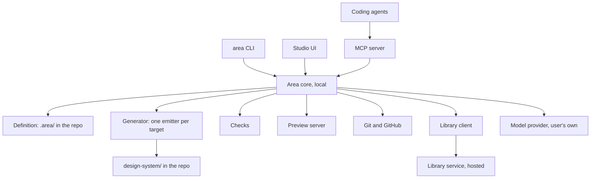

# Area: technical brief

Sep 27, 2026 · @Ethan

This brief is the product scope for Area. It supersedes "Code-Native Design System
Workspace" (Sep 17, 2026). That brief was aimed only at established design teams and led
with enforcing an existing system. This one is broader and simpler: anyone can create a
design system of their own from a large first-party library, and Area writes it to their
repository and keeps it current. What carried over from the earlier brief and what changed is
listed [at the end](#changes-from-the-sep-17-brief).

> **Status on 2026-10-19.** Committed to the repository unchanged from the owner's draft of Sep 27,
> except for this note. Where today's work differs from the text below:
>
> - **The app.** The Studio exists now, as the Electron app in `apps/desktop`. It is the source of truth and is built
>   only from Area (owner, 2026-10-12). `AGENTS.md` mentions a later IDE / VS Code fork, but the section
>   [Surfaces](#surfaces) below rules out an editor fork. That choice is still open.
> - **What exists.** "What exists today" is out of date:
>   - there are 116 families, 115 of them owner-approved, in `apps/desktop/src/content/component-status.mjs`;
>   - there are 23 settings, most of them one number, not seven presets;
>   - there are about 730 Area icons;
>   - the gallery is the app, not `npm run dev` pages.
> - **Foundations.** Layer 1 is well under way: continuous Radius, Density, Type, Layers, Stroke, the depth controls,
>   Motion and Material. There are no named looks (owner, 2026-10-18), which fits "real alternatives" below.
> - **Not started:** inventory selection, structure alternatives, the generator, CLI and lock, GitHub output, the
>   agent contract (MCP), import and publishing.
> - **Not in this brief:** the app's Brand tab and its Chat view, an agent chat in the Inspector.
>
> How the library grows toward this scope is in [Governance](GOVERNANCE.md). What it looks like and why is in
> [Principles](PRINCIPLES.md).

## Summary

Area is a design system tool that writes to GitHub. Anyone who builds software can create a
design system that is theirs alone. They start from a large first-party library of
components and UI examples and make a series of simple visual choices. Area writes the
result into their repository as code. A change to the system shows up instantly on the
shipped screens and explorations kept in Area, and reaches the repository after review.
Teams get one place to see their system, their shipped UI and their explorations.

Area has four parts:

1. **Library.** A large first-party collection of components, variants, layouts, UI
   examples, motion studies and experiments. Every item is live code, not a screenshot or a
   video, and renders in any Area design system. Later, anyone can publish their own work to
   it in one step.
2. **Builder.** The guided process that turns choices into a design system: which
   components and variants to include, and how everything looks and is built.
3. **Workspace.** Where a design system lives once it exists, in three zones: System,
   Product and Lab. A change to the system appears live on every screen and exploration
   that uses it, and is reviewed before it ships to code.
4. **Output.** The design system as source files in the user's GitHub repository, for the
   frameworks they use, kept current by Area.

The thesis: AI can generate almost any interface. The unsolved problem is keeping what gets
generated consistent and of high quality while a product keeps exploring and changing. A
design system is the layer that holds that consistency. Today it is too hard to make, too
uniform when it comes from a template, and too scattered to manage.

## Need

**Generation is solved. Consistency is not.**

- Prompt-first tools (Claude Design, v0, Lovable) produce screens quickly. Each screen is a
  one-off: nothing ties the next one to it.
- Coding agents drift from a team's system unless they have a machine-readable contract.
  They write raw hex and px values instead of tokens
  ([Superdesign](https://superdesign.dev/blog/cursor-for-design)) and generate near-duplicate
  components instead of reusing existing ones
  ([Builder.io](https://www.builder.io/blog/cursor-design-mode-visual-editing)).
- Output quality tracks the quality of the design system the agent is given
  ([Progress](https://www.progress.com/blogs/designing-on-the-canvas-with-agents)).

**Design systems are hard to make, and they look alike.**

- A complete system takes a dedicated team. Most products start from a template (shadcn,
  Material, Tailwind UI) and change a few colors and a radius.
- "Customizable" systems expose a handful of global settings such as accent, radius and
  light/dark. Structure, material, density and component anatomy stay fixed, so the result
  still looks like the template.

**Design systems are managed in the wrong places.**

- Figma was built for drawing. A team's components, shipped screens and explorations spread
  across pages and files, with no record of what is approved or what shipped.
- The code that ships lives in GitHub, which is too technical for most designers and
  non-engineers. StackBlitz and Cursor are built for engineers.
- The Figma library and the coded library are two representations that people keep in sync
  by hand.

**Inspiration is static and scattered.**

- Much of the best design work exists only as screenshots, recordings and posts spread
  across inspiration sites, social media and GitHub repos. None of it can be used directly:
  to build from a reference, someone rebuilds it.
- Sharing work means recording the screen, exporting assets and posting to several sites
  one by one.

## Users

Area is for anyone who builds interfaces. There are two ways in.

| Path | Who | Starts with | Gets |
| --- | --- | --- | --- |
| New system | Founders, indie builders, designers, engineers, students, anyone building with AI | Area's library | A complete design system of their own, written to their repo |
| Existing system | Startup designers, design system teams | Their current tokens and components (repo first, Figma later) | A visual home for the system: see it, manage it, extend it from the library, keep product and system in step |

The interface assumes no knowledge of Git, terminals or code. Everything underneath is still
real code in a real repository, so engineers lose nothing and can work in their own tools.

## Product

### How work is organized

There are four places, each with one job.

| Zone | Holds | State |
| --- | --- | --- |
| **System** | Foundations, components, the chosen variants, usage rules | Canonical: merged on the repository's main branch. Drafts show live in Area until they ship |
| **Product** | Shipped screens and flows, rendered in Area from the repository's code | Canonical: what is live |
| **Lab** | Explorations, experiments, motion studies, library items being tried | Exploration: not yet adopted |
| **Library** | Area's collection and published work | Public and versioned |

Work moves in one direction: Library → Lab → System or Product, through review. Anything in
Lab is eventually adopted or archived. Canonical is derived from the repository (merged on
main), never set by hand. Every item has a zone, a state, an owner and an origin, so nothing
is lost in a forgotten page or file.

### Customization model

A design system in Area is a set of choices in four layers. Each layer is harder to offer
than the one before it, and more distinctive.

| Layer | What the user chooses | Examples |
| --- | --- | --- |
| 1. Foundations | Values every component reads | Color (neutral ramp, accent, status tones, light and dark), type (family, scale, weights, tracking), shape (radius per role), density and spacing, stroke, material (flat, outlined, raised, translucent), elevation, motion (duration, easing, amount), icon set and weight |
| 2. Inventory | Which components, variants, sizes, tones and states are included, and the defaults | Button with solid, soft and ghost but no outline; three sizes; no danger tone |
| 3. Structure | Anatomy and layout per component family | Tabs as underline, pill or segmented; fields outlined, soft or underlined; labels above or inline; where a close button sits; card layouts |
| 4. Patterns | Screens, flows and layouts built from the components | Settings page, chat thread, table view, onboarding |

Most customizable systems stop at layer 1 and offer a few presets. Area gets its range from
continuous values in layer 1 and real alternatives in layers 2 and 3. Two systems made in
Area should not look related unless their authors chose that.

**Guardrails.** A wide range is only useful if every combination still looks right. Each
option carries rules that the builder enforces:

- **Color:** contrast is checked for every text and control role in both modes. Options
  that fail are never offered.
- **Geometry:** insets, icon boxes, concentric radii and first-line alignment follow shared
  rules, so a density or radius change keeps every component aligned.
- **Scope:** every library item declares which options it responds to, so no option
  reaches an item that does not support it.
- **Consistency:** example screens re-render on every change and are compared visually.

### Building a system

The builder asks one question at a time. Each question is shown as rendered alternatives on
real screens, so the user picks what looks right instead of adjusting sliders. Every step has
a default, so the user can stop at any point and ship. Progress is saved, and any choice can
be revisited.

1. **Start** from Area's baseline, a style from the library, an existing system, or a
   description with reference images.
2. **Foundations:** color, type, shape, density, material, motion, icons. Each step shows a
   few rendered options on the user's chosen example screens.
3. **Inventory:** choose components by category, then include or exclude each family's
   variants, sizes and tones. Area shows what each choice affects.
4. **Structure:** for each family, choose its anatomy from rendered alternatives.
5. **Fine-tune (optional):** pairwise comparisons that change one value by one small step.
   The step size adapts, halving on each reversal, until the user stops seeing a difference.
6. **Review:** every example screen in the new system, with contrast and consistency results.
7. **Ship:** choose target frameworks, connect or create a GitHub repository, and write.

### Bringing an existing system

- **Import** tokens (DTCG, Style Dictionary, Tailwind theme, CSS custom properties), then
  components (exports, prop types, variant definitions, Storybook stories), then Figma
  variables and components.
- **See it:** Area renders the imported system in the workspace: every token, component and
  variant, and the product screens that use them.
- **Find problems:** duplicate and conflicting tokens, raw values that should be tokens, and
  near-duplicate components are listed.
- **Extend it:** library items are adopted into the imported system. They are mapped to its
  tokens, tuned to its values and rewritten in its conventions, and they arrive in Lab.
- **Limit:** Area fully re-themes only components built on its schema. Imported components
  are shown and managed as they are, and can be migrated one family at a time.

### Changing the system: live in Area, shipped after review

A change to the system shows up everywhere in Area at once. It reaches code only after it
is reviewed.

1. **Draft.** Changing a foundation, variant or structure option creates a draft of the
   system. Area re-renders everything that uses it straight away: the System's components,
   the Product's shipped screens, Lab explorations and library previews. Foundation changes
   (color, type, shape, density, material, motion) are instant because they are token values
   swapped into the rendered screens. Inventory and structure changes need a quick rebuild of
   the preview.
2. **Compare.** Switch any screen between shipped and draft, or view them side by side. Area
   lists every affected screen with a visual diff and the check results.
3. **Ship.** Once the draft is approved, Area writes it to the repository (see
   [Output model](#output-model)). Teams get a pull request with before-and-after
   screenshots and the check results; solo projects can commit directly. Until then the
   repository does not change.

Several drafts can exist at once, so two directions can be compared on the same shipped
screens. Lab items follow the current draft by default and can be pinned to a system
version for comparison. Designing a new product works the same way: change the overall
visual style mid-design and every screen follows immediately; nothing is written until the
user ships.

**What the Product zone holds.** Shipped screens and flows, documented as items in Area and
rendered from the code on the repository's main branch (routes or stories). They are the
real shipped code, not screenshots, which is why a draft can be tested on them. Screens
built with the system's components and tokens change with a draft. Values hard-coded in
shipped code do not; Area marks them, so the user sees what a system change would miss, and
the literal check can convert them to tokens.

Screens run on fake data, as a Figma prototype does. Area supplies sample content and stubs
sign-in and backend calls, so any screen can render without the product's services. Real
data is not needed to judge a design change.

**Handoff.** Developers take work over in the same tool. A shipped draft or an adopted Lab
item is a branch in the real repository, and Area's code view, or the developer's own editor
on that branch, shows exactly what changed. There is no export and no separate spec to
translate.

**Agent contract.** The system is exported as an MCP server, agent rules and a DESIGN.md, so
Claude Code, Codex, Cursor and other agents build inside it. The same checks run on their
changes as on the user's (see [Checks](#checks)).

### Library

- **First-party at launch.** Every item is built by Area. Each is informed by the best
  shipped products and design systems and changed enough to be Area's own. References
  supply measurements and patterns; their code, icons, assets and copy are never copied.
  Each item records its references.
- **Breadth is the point.** Every common component in many layouts, appearances, sizes and
  interaction patterns; UI examples (screens and flows); motion studies; icons; experiments.
  A new system should find most of what it needs already built.
- **Live, and in your system.** Every item is interactive and built on the shared semantic
  schema, so it renders in the viewer's own design system. One action adopts it into Lab.

### Publishing

- One action publishes an item from the workspace to the Library. The item gets a public
  page with the live item, its source, the system it uses and its license.
- Area records the media itself: stills, a clip of the interaction or motion, and a link
  card. There is no separate screen recording or export. Posting to connected accounts
  from the same action is a later option.
- Published items built on Area's schema re-theme for anyone who opens them.
- Community publishing opens after the first-party library is established. It needs
  moderation, license terms and sandboxing for published code.

## Output model

This decision defines what lands in the user's repository when a change ships. It does not
affect live changes inside Area: previews render from the system definition directly, for
every model.

| Model | In the repository | Ownership | When a change ships |
| --- | --- | --- | --- |
| Installed package | A dependency; the code lives in a registry | Can't edit it | Bump a version |
| One-time copy (shadcn's model) | Source files | Full | Updates stop; re-copy by hand |
| **Managed source (chosen)** | Source files, plus a record of how they were generated | Full | Area regenerates and merges |

Managed source fits the draft-then-ship flow: the user owns the code, and shipping a
reviewed draft is a regeneration Area can apply safely. Area writes ordinary files the user
owns and can edit. It keeps the choices and a lock file beside them. When a system change
or a library update ships, Area regenerates and compares three versions: what it generated last time, what the user changed
since, and what it generates now. Clean changes apply; conflicts are listed for the user to
choose. The user's own edits are kept.

```text
.area/
  system.json       the choices: foundations, inventory, structure
  area.lock         library versions and a hash of every generated file
  rules/            usage rules and deliberately kept literal values
design-system/      generated: tokens, styles, components per target, docs
```

Generation is deterministic: the same choices and library version always produce the same
files. That is what makes the merge, review and pull requests reliable.

## Frameworks and targets

Area is open to every language and framework. It keeps one framework-neutral definition and
generates each target from it.

- **The definition** is what the library stores: tokens in DTCG, and for each component its
  anatomy (slots), options manifest, states (native and ARIA), keyboard behavior and
  reference CSS.
- **Targets:** CSS custom properties and HTML first, since they work in any web stack; React
  next (built today); then Vue, Svelte, Web Components and a Tailwind theme; native targets
  (SwiftUI, Jetpack Compose, Flutter) as demand requires. Tokens export to every target
  early. Components need an implementation per target.
- **Conformance.** Ports are written by agents from the reference implementation. A port is
  accepted only when it passes the component's conformance suite: rendered geometry and
  paint measured with Area's capture script, plus behavior tests. The suite is the contract,
  not any one port.
- Web targets share the CSS. Native targets need their own rendering and cost much more per
  component.

## Technical architecture

Everything that touches the user's code runs on their machine. The hosted parts are the
library, publishing and accounts. No user code is sent to Area's servers unless the user
publishes it.



### Surfaces

- **`area` CLI:** `init`, `add`, `build`, `check`, `publish`, `studio`. Terminal users and CI
  use it directly.
- **Studio:** the local interface, opened by `area studio`: in the browser first, later as a
  desktop app. It is a purpose-built shell, not an editor fork: builder, zones, previews and
  library. There is no file tree, terminal or editor by default. A code view is hidden by
  default and is where developers pick up handed-off work.
- **Library site:** browse, preview, adopt and publish. Hosted.
- **MCP server:** tools such as `system.search_components`, `system.get_component`,
  `system.resolve_token`, `system.validate_diff`, `preview.screenshot` and
  `library.get_item`.

### GitHub

- Sign in with GitHub (a GitHub App) to create a repository or choose one.
- Git terms are hidden by default: saving creates a commit on a working branch, proposing
  opens a pull request, shipping merges it.
- Pull requests carry before-and-after screenshots and the check report.
- A local folder works without GitHub. Other Git hosts come later.

### Definition and generator

- The system config is a vector of parameters plus selections. Tokens are generated from
  the parameters, not typed in: for example, a neutral ramp in OKLCH from a few values.
- Previews read the draft definition directly. Foundations are emitted as CSS custom
  properties and swapped in place, so they need no file writes or rebuild. The generator
  writes files only when a change ships.
- One emitter per target. Output includes only what the user chose: excluded variants emit
  no CSS, and their types are not exposed.
- The lock file records library versions and generated-file hashes for the three-way merge.

### Library items

- Each item ships with its source per target, stories for every state, tests, a version, an
  options manifest (which parameters and slots it responds to) and its provenance
  (references and spec).
- Items share one semantic token schema, so any item renders in any Area system.
- Distribution is a versioned registry. React items are also published in shadcn registry
  format.

### Checks

These come from the Sep 17 brief's enforcement engine, narrowed to what the builder and the
workspace need.

- Contrast for every text and control role, in every mode.
- Geometry: insets, icon boxes, concentric radii, first-line alignment.
- Manifest parity: styles and the options manifest agree in both directions.
- Literals: raw values in changed code are resolved to the nearest token, bound
  automatically when exact, proposed when close, flagged otherwise.
- Duplicates: new components are compared with existing ones by props, structure and
  rendered appearance.
- Visual diff of example and product screens; changes outside the edited area are flagged.
- Accessibility (axe-core) on rendered screens.

The same checks ship as CLI commands and lint rules, so engineers' pull requests pass
through them in CI.

### Security and privacy

- Local-first. The repository stays on disk. Model calls go to the provider the user
  configures: their own key or an existing agent subscription.
- Publishing is always an explicit action. Uploaded fonts stay local and are never
  redistributed.
- Telemetry is opt-in and never includes source content.

## What exists today

This repository is the start of the Library and the foundations of the generator.

| Part of the brief | In the repository now | Missing |
| --- | --- | --- |
| Library: components | 57 component families in framework-free CSS and React. The registry (`apps/docs/src/component-status.mjs`) records 45 accepted and 12 in review. Each has a spec and captured evidence. | Range of appearances and structure options; UI examples beyond demos; motion studies |
| Foundations | `packages/tokens`: seven axes as presets (theme, neutral, accent, UI scale, radius, surface, motion), OKLCH palette math, contrast gate | Continuous parameters; material beyond the surface presets; type family choice |
| Options manifest | `packages/styles/src/manifest.ts`: every variant, checked against the CSS | Structure options; per-variant inclusion; options declared per item |
| Guardrails | Contrast gate, `inset.css` geometry rules, cohesion and component tests | Visual diff of example screens; testing combinations of options |
| React target | `packages/react` | Every other target |
| Measurement and conformance | `apps/docs/public/area-capture.js`, capture comparison | A conformance suite per component |
| Preview | Gallery pages (`npm run dev`) | Studio, zones, live system editing |
| Icons | Area's own stroked set, 230+ icons, with a geometry lint | More styles; generation within a set's rules |
| Generator, config, lock and merge, GitHub, MCP, hosted library, publishing | None | All |

The current phase is visual-first: component CSS uses literal measured values. The planned
systematization phase is where layers 1 to 3 become options. It is the core of the product,
not a clean-up step.

## Differentiation

| Area | Compared with |
| --- | --- |
| Customization in four layers, including structure and material, with guardrails so every combination holds up | Theme generators and customizable systems expose a few global settings, and the output looks like the template |
| A live library that renders in the viewer's own system and adopts in one action | Inspiration sites show screenshots and videos; component registries such as 21st.dev ship a fixed look |
| Test a system change live on real shipped screens and explorations, then ship it after review | Figma previews library changes in design files, not in shipped code; code tools change the code directly |
| Writes the system to the user's repository and keeps it current | Figma keeps a second representation; prompt-first generators produce one-off projects |
| One place for System, Product and Lab, with explicit states | Figma files carry no approval state; code tools have no concept of exploration |
| Choices instead of code, on real code | GitHub, StackBlitz and Cursor are for engineers; Figma is not the code |
| One-action publishing of live, interactive work | Recording, exporting and posting to several sites |
| One definition, many frameworks, checked by a conformance suite | Most libraries are one framework, most often React |
| The same contract for people and their agents | Agents reach a system through hand-maintained glue: Figma MCP, Code Connect, rules files |

**Landscape** (carried from the Sep 17 brief; not re-verified for this one):

- Figma is moving toward code: Code Layers, Make on production codebases, Skills for team
  rules, and an agent used weekly by most larger customers. Its canvas stays a second
  representation that must be reconciled with code.
- Running-code design tools (Paper, Subframe, Dessn, Onlook, Cursor Design Mode) edit real
  code. None creates or manages a design system.
- Prompt-first generators (Claude Design, v0, Lovable, Framer) are fast and built for new
  projects, not for a system that persists.
- Libraries and inspiration: Mobbin offers screenshots of shipped apps; 21st.dev offers
  React components with live previews and one-command install.
- Not reviewed: Supernova, Knapsack and zeroheight (documentation platforms), Tokens Studio
  (token sync with Git), and shadcn theme editors. Check their current capabilities before
  relying on this table.

## Build sequence

The component library comes first because everything else depends on it. After it, each
step has a proof point and a stop condition.

| Step | Build | Proof point | Stop or rethink if |
| --- | --- | --- | --- |
| 0 (now) | Baseline library: components and variants from measured evidence | The owner accepts each family | — |
| 1 | Option schema: turn the literal values into foundation parameters, inventory selections and structure options | The whole gallery renders under several very different settings and passes contrast and geometry checks | Combinations need hand fixes one by one |
| 2 | Generator and CLI: `area init` and `area build` from a config file, React and CSS targets, lock file and three-way merge | Two very different systems generated from one library into two repositories; a library update regenerates both cleanly, keeping local edits | Merges conflict on ordinary edits |
| 3 | Builder in Studio: the guided steps, GitHub sign-in, write to a repository | Someone with no terminal experience makes a complete system and ships it to GitHub in under 30 minutes | People abandon it before the end, or the results look alike |
| 4 | Workspace: System, Product and Lab zones, live drafts across shipped screens and explorations, compare, ship as a pull request with visual diffs | A foundation change appears on every shipped screen and exploration instantly, and shipping it opens a reviewed pull request | People still keep their real work elsewhere |
| 5 | Agent contract and checks: MCP server, rules and DESIGN.md export, literal and duplicate checks, CI | Agent-built screens in a user's repository stay within the system | Agents follow the system well without the contract |
| 6 | Import: tokens first, then components and stories, then Figma | A real open-source design system is imported, shown and extended from the library | Each imported repository needs custom adapter work |
| 7 | Public library and publishing: hosted site, "see it in my system", one-action publish with generated media | Items published by one user re-theme correctly in another user's system | Published items break outside their author's system |
| 8 | More targets: Vue, Svelte, Web Components, then native by demand, ported by agents and accepted by conformance suites | A ported component passes the same suite as the reference | Ports need heavy hand work per component |
| 9 | Later: fine-tune calibration, a system that proposes new tokens and variants from usage, icon and motion generation, Figma sync | — | — |

## Risks and open questions

**Scope.** This is broader than the Sep 17 brief: a content library, a generator for many
targets, a workspace, a publishing platform and an import path. Each can ship half-built.
The sequence above keeps each step usable on its own.

**Library cost.** A first-party library is a content operation. Every item is built,
reviewed and maintained across versions and targets. It grows before any revenue does.

**Combinations.** The range of options is the product, and every combination must still look
right. Guardrails reduce the risk; they do not remove it. Testing across options needs its own
tooling.

**Framework long tail.** Every target multiplies maintenance. Native targets need their own
implementations, not only tokens.

**Existing systems.** Real repositories vary widely in frameworks, styling approaches and
monorepo setups. Import may work on a demo and fail on real code.

**Non-technical users and Git.** Merge conflicts, permissions and failed builds must be
explained and resolved without exposing Git.

**Legal.** The library draws on references but must be Area's own: no copied code, assets or
copy, and license checks on anything adapted. Generated assets, published community work and
typefaces need clear terms. Needs legal review before a public launch.

**Competition.** Figma, Claude Design, v0 and the running-code tools can each add pieces of
this. Area's defense is the library's quality and range, and owning the system in the user's
repository.

**Open questions for the owner**

- Pricing: per seat, per system, or free with paid team features; whether the library is
  included.
- Whether "publish once" also cross-posts to social accounts, or produces media to post.
- When the Studio moves from the browser to a desktop app.
- Whether published community items must be built on Area's schema, which is what lets them
  re-theme.

## Changes from the Sep 17 brief

| Kept | Changed | Dropped or deferred |
| --- | --- | --- |
| Canonical defined by merged code; explorations adopted or archived | Target user: anyone who builds, as well as established teams | "All or nothing" framing and enterprise-first sequencing |
| Local-first, user's own model provider | Lead feature: creating and customizing a system, not enforcing one | Crawling a whole Figma estate (becomes a later import source) |
| Agent contract: MCP, rules, CI checks | Library is the core and a public destination, not an adoption step | Learning loop and asset generation (deferred to step 9) |
| Tokens generated from parameters; pairwise fine-tuning | Zones named System, Product, Lab and Library | Editor-fork option (Studio is a purpose-built shell) |
| Purpose-built shell with code hidden | All frameworks through one neutral definition and conformance suites | — |
| First-party, parameterized library components | Output: managed source files, regenerated and merged | — |
