# Area figures (2026-10-24)

Area's own illustration style for theme visuals: real Area components rendered as UI, every word drawn as a light
shape, numbers as digits, lines at exactly 1px. Built over eleven rounds with the owner on 2026-10-24, from the
Hairline trial (PR #157). **Next:** combine with a new theme creation process (owner, 2026-10-24: "i will pick it up in
a new session that combines with a new theme creation process"). The app is unchanged.

## Pick up here

- **See it:** the review page https://claude.ai/artifact/V1qnJfnVQ8Y1WhkUAFNgkt (owner's private artifact; flags and
  notes save to its ArtifactData collections `gallery` and `axes`, empty as of round 11), or build it locally:
  `npm run build` (for `packages/styles/dist/area.css` and the packages' dist), then
  `node docs/research/area-figures-2026-10-24/build.mjs` → `page/index.html` (gitignored), served over http.
  The captures below are from round 11 at size M.
- **Make or change one:** the skill `.claude/skills/area-illustration` (`SKILL.md` first; `style.md` is the look,
  `rules.md` the rules). Its files:

| File | What it holds |
|---|---|
| `engine/abstract.css` | The three draws (Bars, Shapes, Real): word shapes, digits, held states, zoom, 1px strokes, tile layouts |
| `engine/stage.js` | `AFS.stage`: frame, zoom fit, centring on painted bounds, held states, pointer, field text shapes |
| `figures/screens.jsx` | 14 desktop screens, 6 iPhone screens, 16 vignettes, from Area's components |
| `figures/compositions.jsx` | 5 compositions, one per theme setting (Accent, Strokes, Corners, States, Status) |
| `figures/index.jsx` | `SHOW` (each family's specimen and layout), `SETTINGS` (each setting's figure), `render()`, word wrapping |
| `build.mjs` | Renders the figures to markup (esbuild + react-dom/server) and writes a bench |

## Visuals

Screens (desktop 1024 × 576, iPhone 390 × 844 at type 16, density 36):

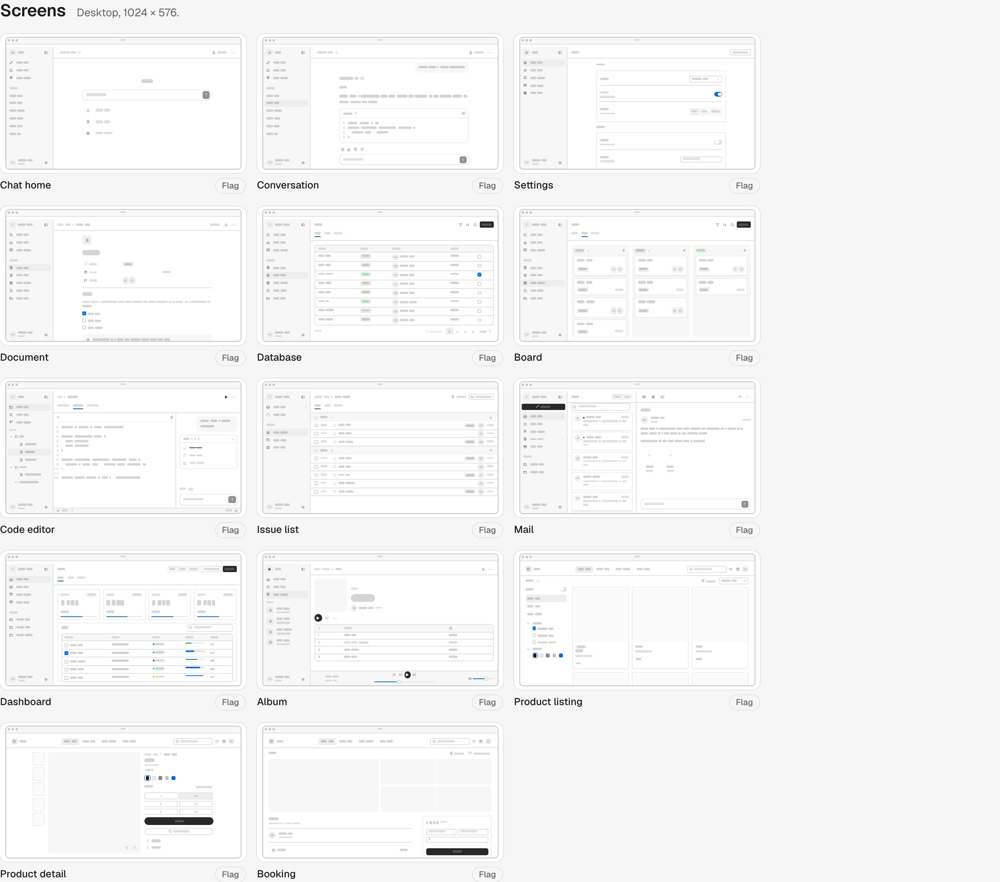
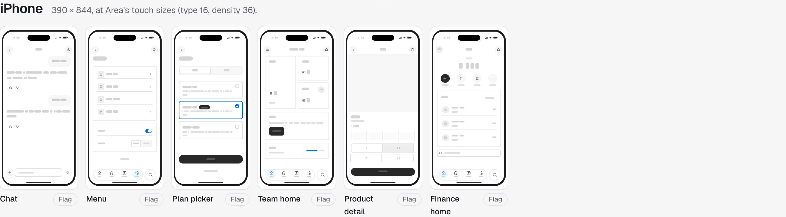

Vignettes, components in context (480 × 360), light and dark:

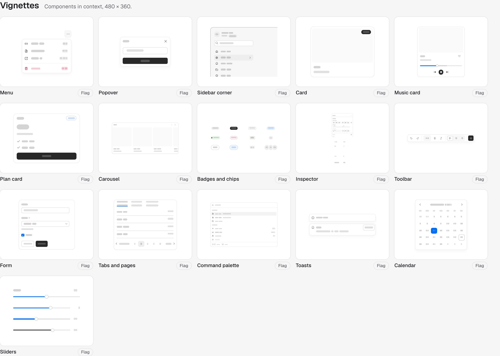
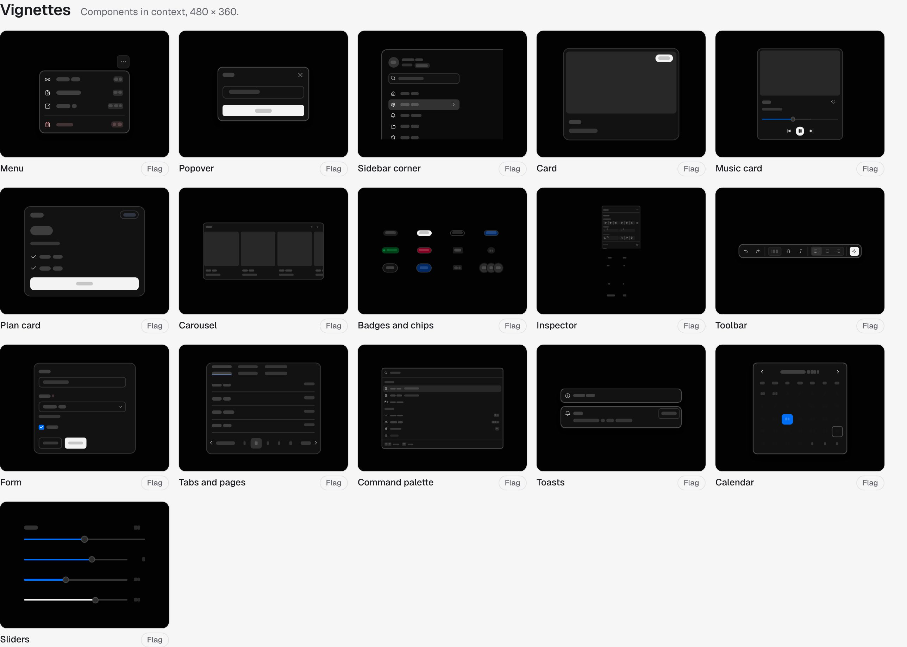

Compositions, one per theme setting, meant as that setting's visual:

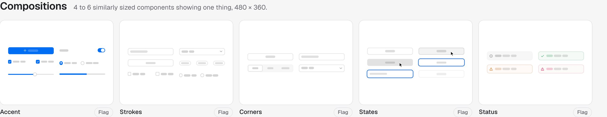
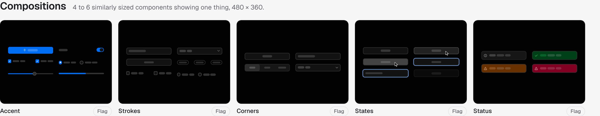

Every component family, one specimen each, by kind:

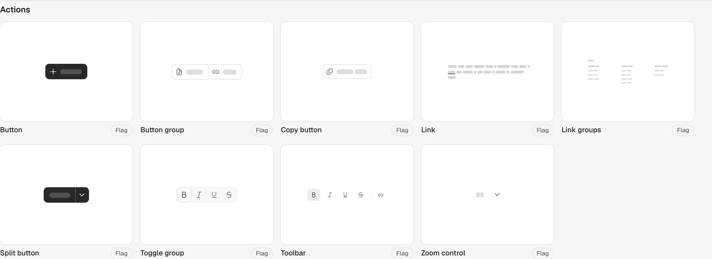
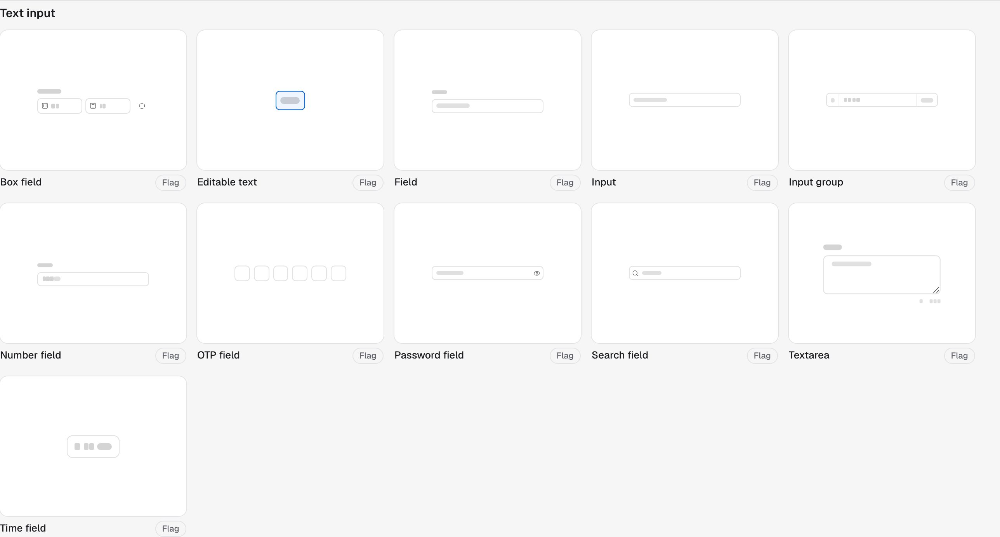
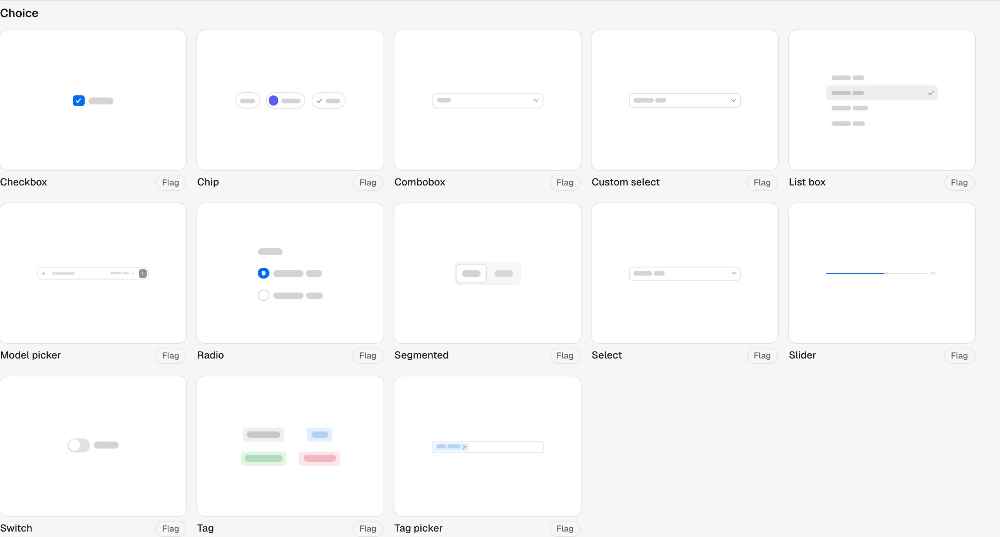
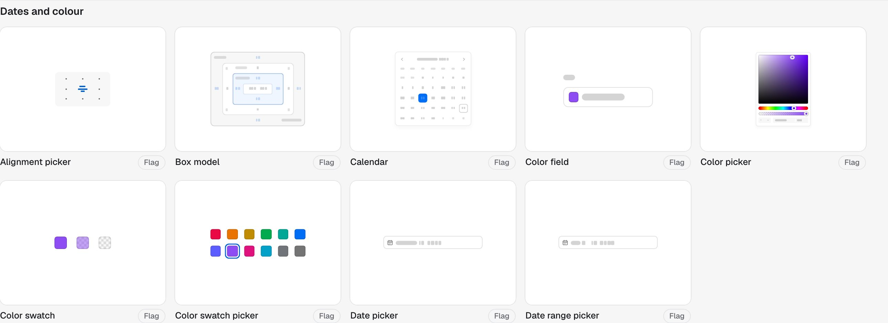
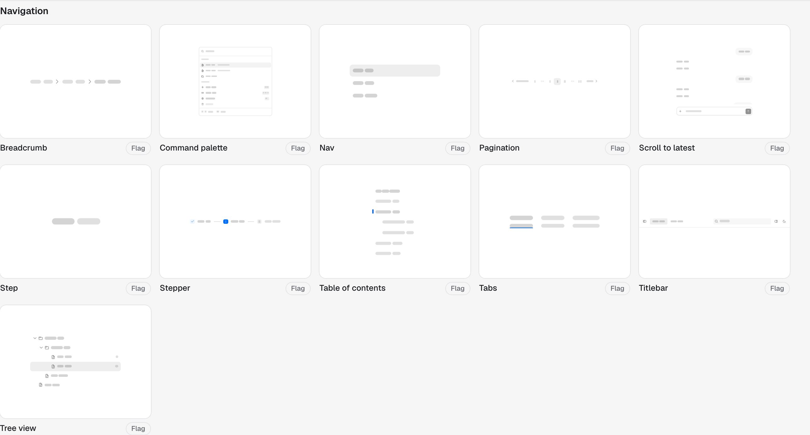
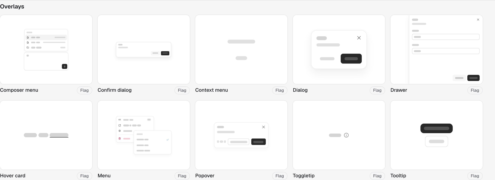
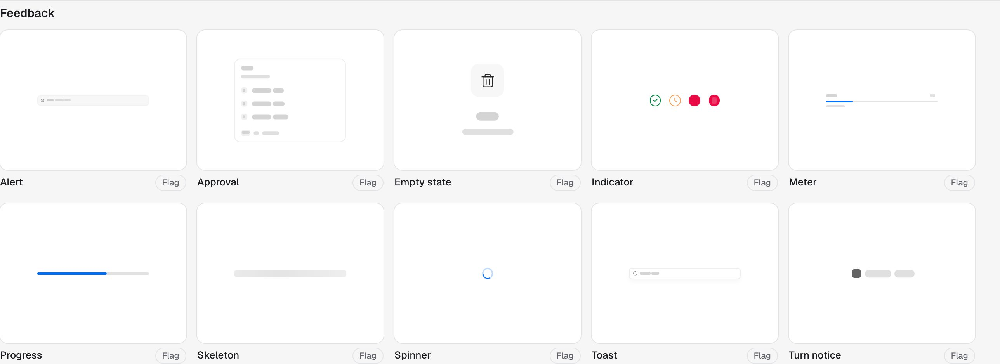
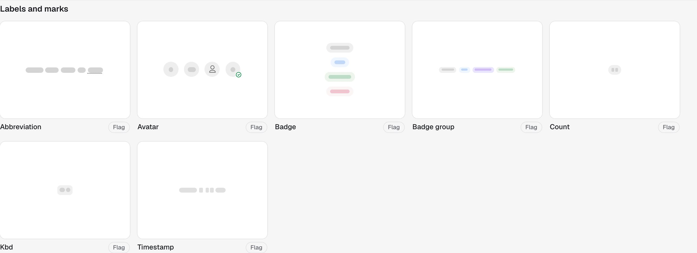
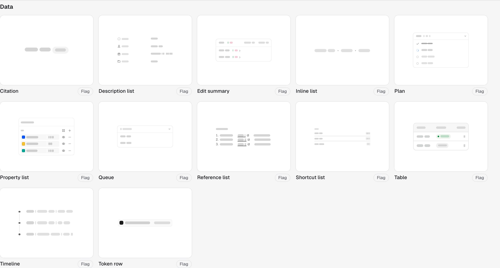
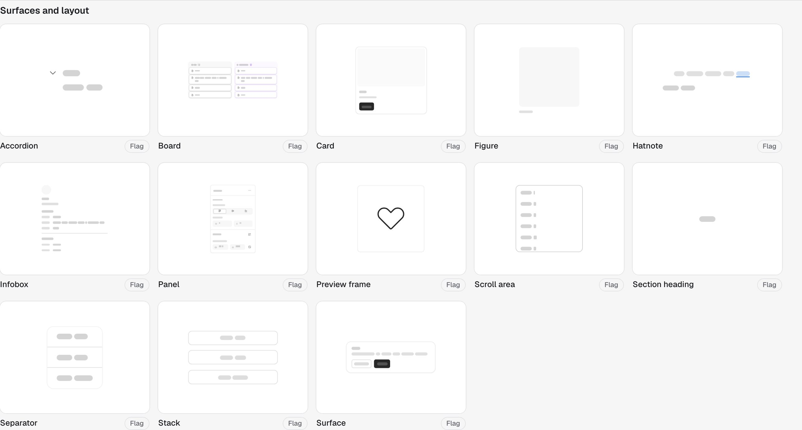
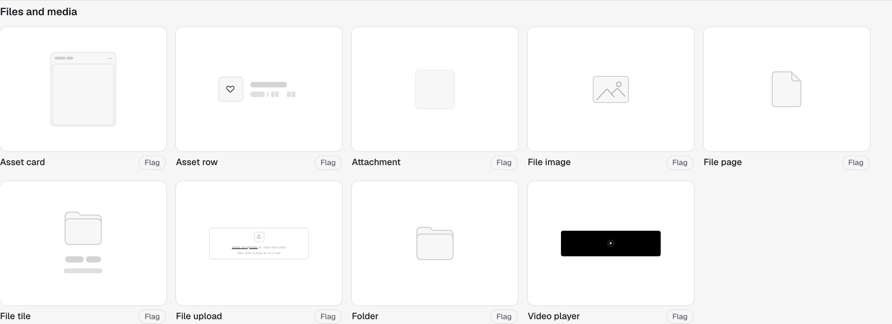
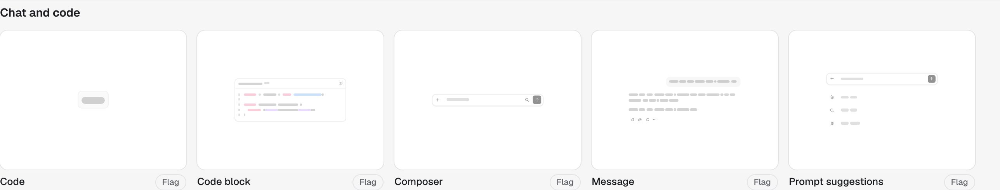

Theme settings, each option on the screen that shows it (desktop), for example Accent and Stroke width:

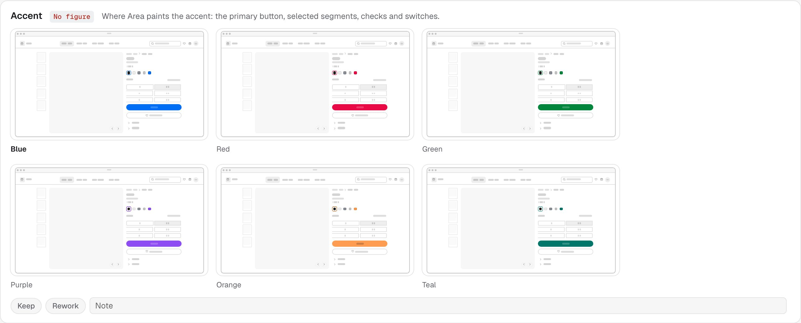
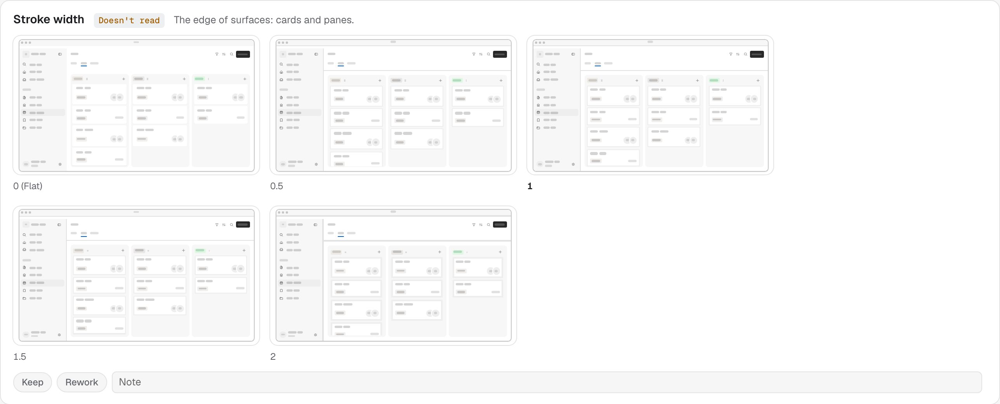

## Each setting's figure

From `SETTINGS` (figures/index.jsx). "In the app today" is the audit of the Theme tab's current option figures
(`apps/desktop/src/choice-figures.tsx`): none, doesn't read, or reads.

| Setting | Desktop screen | iPhone screen | Vignette | In the app today |
|---|---|---|---|---|
| Mode | Dashboard | Team home | Card | none |
| Neutral | Document | Menu | Sidebar corner | reads |
| Tint hue | Mail | Menu | Sidebar corner | none |
| Light tint | Mail | Menu | Sidebar corner | doesn’t read |
| Dark tint | Code editor | Menu | Inspector | doesn’t read |
| Text tint | Document | Chat | Card | reads |
| Accent | Product detail | Plan picker | Form | none |
| Accent strength | Product detail | Plan picker | Form | none |
| Light solid | Chat home | Plan picker | Form | none |
| Dark solid | Chat home | Plan picker | Form | none |
| Label tint | Chat home | Plan picker | Form | none |
| Status colours | Database | Finance home | Badges and chips | none |
| Light ground | Booking | Finance home | Card | reads |
| Dark ground | Album | Finance home | Carousel | reads |
| Light layers | Mail | Team home | Sidebar corner | doesn’t read |
| Dark layers | Code editor | Team home | Inspector | doesn’t read |
| Light card tone | Product listing | Team home | Card | doesn’t read |
| Dark card tone | Product listing | Team home | Card | doesn’t read |
| Action | Chat home | Plan picker | Form | none |
| Selection | Settings | Plan picker | Form | none |
| Contrast | Database | Menu | Inspector | doesn’t read |
| Type size | Conversation | Chat | Card | none |
| Density | Issue list | Menu | Menu | reads |
| Radius | Board | Plan picker | Card | reads |
| Pills | Settings | Product detail | Badges and chips | doesn’t read |
| Stroke width | Board | Team home | Carousel | doesn’t read |
| Stroke strength | Database | Menu | Inspector | doesn’t read |
| Hover stroke | Settings | Finance home | Form | doesn’t read |
| Selected stroke | Product listing | Product detail | Menu | reads |
| Focus ring | Chat home | Chat | Form | reads |
| Rest shadow | Settings | Finance home | Card | doesn’t read |
| Floating shadow | Database | Chat | Menu | doesn’t read |
| Resting shadow | Product listing | Team home | Card | doesn’t read |
| Hover shadow | Board | Team home | Music card | doesn’t read |
| Field shadow | Booking | Finance home | Form | doesn’t read |
| Shadow size | Product detail | Team home | Menu | doesn’t read |
| Shadow softness | Mail | Menu | Menu | doesn’t read |
| Shadow light | Dashboard | Plan picker | Toolbar | doesn’t read |
| Shadow colour | Board | Team home | Toasts | doesn’t read |
| Hover fill | Issue list | Menu | Sidebar corner | doesn’t read |
| Selected fill | Document | Plan picker | Sidebar corner | doesn’t read |
| Pressed fill | Chat home | Finance home | Toolbar | doesn’t read |
| Selected tint | Product listing | Product detail | Menu | doesn’t read |
| Danger hover | its own vignette (danger-menu) |  |  | none |
| Motion | its own vignette (motion) |  |  | reads |
| Easing | its own vignette (easing) |  |  | reads |

## Into theme creation

**Built 2026-10-24 (branch `claude/theme-questionnaire-builder-1df19a`):** Setup's stage is one product screen drawn
with this engine (`apps/desktop/src/setup-screen.tsx`). The app's build copies `engine/abstract.css` into
`dist/styles/figures.css` (unlayered, as the skill's pages load it); words are wrapped by `engine/markup.js`, now shared
by `figures/index.jsx` and the app. The screen renders once per set of held states to static markup, and its choices'
cards show close-ups of it under each choice. The proposal below is kept for the per-setting figures, which are not
ported yet.

### The proposal (2026-10-24)

The Theme tab's grid option cards draw hand-made figures (`choiceFigure` in `apps/desktop/src/choice-figures.tsx`,
35 settings, `cf-bar` bars). These figures could replace them:

- They are real components, so the app can render them live in React with `abstract.css` and the zoom staging: no
  static build. Each option card shows its setting's figure under the option's own scope (the Accent composition in
  red on the Red option), so every option is its true tokens.
- Cards are small: compositions and vignettes fit them; full screens suit settings whose effect is the whole window
  (Mode, Ground, Layers, Neutral, tint), perhaps as a larger preview beside the list.
- Render lazily (only the visible category); 46 settings × their options are many real component trees.
- It is an app change: run `area-component-intake`, follow `docs/GOVERNANCE.md`, and keep `abstract.css` and
  `stage.js` as the one engine (the skill and the app should share it, not fork it).

## Open items

- Weak tiles from the last audit: Context menu and Hover card show only their trigger (show the open menu and card);
  Zoom control is faint; OTP field is empty boxes (give it digits); Spinner, Count, Kbd and Section heading stay small
  at the 1.8× cap; the Calendar vignette has a stray outlined day.
- Compositions for more settings (Type size, Density, Elevation, Ground and Layers) in the same shape.
- The page's per-setting badges ("No figure", "Doesn't read") describe the app's current figures, not these.
- Danger hover's figure uses `danger-surface-hover`, close to but not the Menu's derived plate.
- No Material, System (Mode follows the OS) or numeric accent hues; no automated check of figures beyond the
  browser sweeps (centring, empty tiles, stroke widths) run by hand in each round.
- Hairline (`@lucasmarkes/hairline`) is still in Testing from PR #157; this work keeps none of its code (credited in
  THIRD_PARTY_NOTICES.md).

## History

### Round 1: Hairline in Area's colours (superseded)

The trial merged in PR #157 put six figures from `@lucasmarkes/hairline` 0.5.1 above Empty state in the
Testing tab. Round 1 rebuilt the style as Area's: an SVG engine with iso, flat and layered views, 15 colour
roles mapped to tokens, 16 figures after Hairline and the owner's circled Medusa UI references. Picks
collections `figures` and `decisions` stayed empty.

### Round 2: Area's own language, theme settings first (superseded by round 3)

Owner, 2026-10-24: strokes in one colour; components that look and feel like Area's; flat is best; the
style shouldn't stray from Area; rewrite the skill around Area's design language (light, consistent
strokes, icons, shapes) for all drawn UI; focus on the theme axes that need visuals.

- **Skill rewritten** (`.claude/skills/area-illustration`): HTML and CSS instead of SVG. The kit
  (`engine/kit.css`, `engine/kit.js`) draws Area's parts at `--af-k` 0.6 (0.42 on a card) from tokens:
  window, sidebar, card, menu, row, field, button, check, radio, switch, segmented, chip, badge, count,
  avatar, travel, bars, Area icons from `packages/icons/sources`, cursor. One outline (`edge-control`
  at `border-width`), Folder's quiet ink for bars and icons. Stroke widths, shadows, rings and fills are
  true. The SVG engine, iso and layered views, and Hairline's figures are removed.
- **Setting figures** (`figures/settings.js`): 20 scenes and 46 settings from the Inspector's seven
  groups. 12 have no figure in the app (Mode, Tint hue, Accent, Accent strength, Light/Dark solid, Label
  tint, Status colours, Action, Selection, Type size, Danger hover), 24 have one the audit found doesn't
  read, and 10 that read are redrawn so the set is one language. Material isn't covered.
- **Screens** (`figures/screens.js`): No results, Drop to upload, Chat, Light or dark.
- **The page** shows each setting's options at card size (140 × 90) or large, with the app's current
  figure for the same options beneath (`choiceFigure`, rendered from `apps/desktop/src/choice-figures.tsx`
  by `today.tsx`). A bar sets Theme, Size, Outline, Neutral, Accent and whether to show only settings that
  need a visual. Picks: collection `axes` (`{verdict: keep | rework, note, at}` per setting id) and
  `round2` (`replace`, `outline`, `scale`, `true-size`, `views`).

### Round 3: component first, isolated (superseded by round 4)

Owner, 2026-10-24: buttons and controls looked off; start with each component, abstract it, simplify it to
subtle strokes and fills, then construct UI from those; no buttons, switches and checkboxes side by side;
isolated components (menus, colour picker, buttons).

- **Real components** (`real.tsx`): 17 specimens rendered with `@area/react` at type 14, density 32, radius 8
  and measured in the browser. Buttons, fields, rows and segmented tracks: 32 tall, radius 8 (button inset
  10, field 8). Switch track 32 × 20 (`mark-toggle`) with a 16 thumb inset 2. Checkbox 16 with radius 4.
  Menu radius 12 (`radius-list`), inset 4, `border-float`, rows 32 (`ui-row`) with radius 8. Colour picker cells
  28 (radius 8), swatches 20 (radius 4), chosen ring 2. Badge and chip 20 (`mark-label-md`). Avatar 32. Card
  radius 16, inset 16.
- **Kit rewritten** in component pixels (`--c` = the real px × `--af-k`) from those tokens, then quieted: one
  outline, one soft fill, text bars 0.24 of the type size and as wide as the real label, Area icons. The card
  size is the master at exactly half, and each figure has its own scale `z` so a part fills its frame.
- **Components section** (`figures/components.js`): each part real at true size, abstracted at true size, then
  alone as a figure, with what it keeps and drops. Picks: collection `components`.
- **Settings on one component each**: switch (Accent, Accent strength), button (solids, Action, Label tint
  with its real label), checkbox (Selection), badges (Status), a short field (Contrast, Stroke width and
  strength, Hover stroke, Focus ring, Field shadow), a short card (Selected stroke and tint, Rest, Resting and
  Hover shadow), menu (Radius, Floating shadow and details, Hover and Pressed fill, Danger hover), nav
  (Density, Selected fill), slider with ghost thumbs (Motion, Easing), the one part (Pills). Page colours use
  the shell built from the parts.
- **Screens** rebuilt from the parts, each with one kind of control.
- Decisions (`round2` collection, new keys): `text` (bars or real words), `icons` (Area icons or soft
  squares), `isolated`.

### Round 4: real components, bars at ink height, one normal scale (superseded by round 5)

Owner, 2026-10-24: the figure changed too much from the abstraction; the text bars were too thin (make them the
ink's height, a much lighter fill); the real card looked wrong; the nav was blue; bring back the round-12 UI
illustrations (product page, dashboard, gallery and the rest). Then, with a reference of dark pages with rounded
bars and a blue button: no text on buttons or badges, just the colour; everything at a normal scale; text not
small or unevenly spaced.

- **No redrawn kit.** Figures are `@area/react` components and the app's demos rendered to markup (the skill's
  `figures/index.jsx`, `render()`), every text node wrapped in `span.tx`; `engine/abstract.css` draws them Bars
  (default), Real or Shapes. Round 3's hand-traced kit is removed.
- **Bars**: a rounded pseudo-element behind each word, the word's width, 0.7em (cap height), its own colour at 20%;
  buttons, badges, chips and counts keep only their colour. The text goes clear, so spacing is real.
- **One normal scale**: `engine/stage.js` scales a whole drawing (transform) at the frame's scale (1 large, 0.5 card),
  shrinking only to fit.
- **The page**: every setting figure is a 400 × 300 page (header, large title, description, one control in the slot or
  a menu over it or the sidebar, three cards), after the owner's reference.
- **The card** is the app's `CardVertical` demo; **the nav's blue** was the review page's `a { color }` leaking in,
  now scoped with `:not(.af-stage *)`.
- **Screens back**: round 12's `screens.jsx` (14 desktop, 6 iPhone, 16 vignettes) moved into the skill with its final
  CSS; the review page shows each as Shapes, Bars and Real. Picks: collection `screens`.

### Round 5: a gallery in the screens' style

Owner, 2026-10-24: "i like the screens designs, can you just focus on that style and recreate the other visuals in
that same style, i want to see a full gallery of just all types of ui, from screens to individual components".

- **The page is a gallery**: 14 desktop screens, 6 iPhone screens, 16 vignettes, and all 119 component families by
  kind of UI (12 kinds). Each family's tile is filled with its own specimens from the app's gallery
  (`COMPONENT_PAGES`, `componentSpecimens`, the demo registry; up to 8 rendered, as many as fit 480 × 360 at true
  size). One scale per kind of frame (M: screens 0.31, vignettes and tiles 0.5); Size S / M / L.
- **Settings on screens**: each option on round 12's chosen desktop screen, iPhone screen or vignette, holding the
  state it needs (`data-st` marks: hover, press, focus, lift, selected, menu), extended to the settings added since;
  Danger hover, Motion and Easing on vignettes of their own. The small page of round 4 is removed.
- Field values go clear in Bars and Shapes (they aren't text nodes); demo images draw as blank media blocks.
- Marks: Flag on any tile (collection `gallery`), Keep / Rework per setting (`axes`), decisions (`round2`).

### Round 6: one specimen per component

Owner, 2026-10-24: liked the box model, calendar, colour picker, command palette and tree view; "1 of each component in
most cases ... 2 if absolutely necessary"; badges and chips okay, but as a grid with each variant centred in its own
cell and few variants; scale some up slightly, keep it consistent.

- Each family shows its first gallery specimen. `SHOW` (figures/index.jsx) holds the exceptions: grids of 6 badge
  tones and 4 chips, tags, avatars and presence marks; two overlapping menus; a user and an assistant message; and a
  better single specimen for Copy button, Editable text, Popover, Count and Zoom control.
- Scale: the section's (0.5 at M); a single specimen may grow up to 1.3× to fill 80% of its frame, a large one shrinks;
  grids at 1.3×.

### Round 7: margins, centring, close groups

Owner, 2026-10-24: larger margins on every card; the drawer full screen; groups clumped together, a row or column
by default (avatars a row, badges a column); "try to center everything vertically and horizontally"; the
badges-and-chips and tabs-and-pages vignettes as tight grids.

- `AFS.stage` takes `center: "contain" | "cover"`: it fits and centres a figure on its painted bounds (every leaf and
  every element with a fill, edge or shadow, cut to its clipping ancestors, skipping wrappers), so a command palette
  or a tall panel sits in the middle of its frame.
- Margins: a tile's figure fills at most 60% of the frame (vignettes 72%), up to 1.3× the section scale (1.15×).
- Groups: avatars a row (12px), badges a column (10px), chips, tags and presence a tight grid (14 × 18px); the
  badges-and-chips and tabs-and-pages vignettes use the same tight grid (`.sx-vgrid`).
- The drawer bleeds (`SHOW.drawer.bleed`, `center: "cover"`).
- Fixed on the way: Progress and Skeleton were empty (a full-width bar has no width in a centred tile; it gets
  240px), the Inspector and Carousel vignettes were small (their clipped part counted), and React's image preload
  links and the video source no longer request app images.

### Round 8: consistency pass

Owner, 2026-10-24: tabs in one line; the titlebar scaled too far down; the drawer should fill the right side; chips in
a row; the message's text placeholders longer; an icon on the button or button group; liked the Panel; strokes a bit
thicker; components' overall size more similar; the theme settings' full screens matching.

- Tabs: a tile hides the tab panel (its text read as a wrapped tab). Titlebar: `center: "width"` at a 420px window.
  Drawer: `center: "right"`, full height against the right edge. Chips: a row of three. Message: the skill's own
  exchange (`SHOW.message.node`) with two lines of reply. Button: Leading icon; Button group: Icon and label.
- Strokes: `.af-z` sets `--area-stroke-width` and `--area-border-width` to hold 0.75px drawn at every scale (was 0.5px
  at M and 0.31px on screens); the frame keeps the Stroke width setting's ratio.
- Sizes: a small component grows up to 1.8× the section scale (was 1.3×). Spinner, Count, Kbd and Section heading stay
  small at that cap.
- Theme settings: staged with the same function as Screens and Vignettes (overflow shrink, vignette centring), rows
  wrap instead of scrolling off the card, 10px corners like the gallery.

### Round 9: compositions

Owner, 2026-10-24: indicators a row; badges and chips a full grid, spaced out more; "a few grid compositions with 4 to
6 similarly sized components that show a specific thing, like for accent color ... or for strokes".

- Indicator tile: a row. Badges-and-chips vignette: a full 4 × 3 grid of equal cells, 24 × 28px apart (badge styles
  and tones, a tag, a count, chips at rest and selected, a key, an avatar group).
- A new Compositions section (`figures/compositions.jsx`): Accent (accent button, switch, checks, radio, slider,
  progress), Strokes (field, select, outline button, empty checks and radios, outline badge), Corners (button, field,
  chip, avatar, segmented, media), Surfaces (card, menu, toast, popover), States (rest, hover, pressed, focus,
  disabled, a focused field), Status (information, success, warning, danger alerts). Controls sit in equal Surface
  cells; surfaces in equal slots. They follow the page's Theme, Neutral and Accent.
- The tabs-and-pages vignette also drops the tab panel's text.

### Round 10: compositions as setting visuals, one stroke width

Owner, 2026-10-24: Board cut off its second column; show two centred with more than two cards each. Only Status of
the compositions liked; no containers; each should serve as a theme visual. A gap in the badges-and-chips grid. Are
strokes the same width at every size? Four sliders. Tabs and pages misaligned.

- Board: the skill's own figure, two columns of four cards, centred.
- Compositions: rebuilt in Status's shape, parts 200 wide in two columns with nothing around them, one per setting:
  Accent, Strokes (Stroke strength and width), Corners (Radius), States, Status. Surfaces dropped.
- Badges and chips: the gap was a plain Count, which has no fill, so drawn as colour only it vanished; now the soft
  Count.
- Strokes were not one width: a transform scaled Area's 1px line to 0.3px on screens and up to 1.3px on large tiles,
  smeared across device pixels. Figures now scale with CSS `zoom` and set strokes to 1.04px ÷ zoom: measured at S, M
  and L in every section, every stroke draws at exactly 1px, and Stroke width's options at exactly 0, 0.5, 1, 1.5, 2px.
- Sliders: four (labelled, plain, accent and neutral). Tabs and pages: one column, tabs on a rule, four rows,
  pagination centred under them.

### Round 11: shapes on every word

Owner, 2026-10-24: text shapes were inconsistent (on Segmented, not on buttons, tags, badges): add them everywhere; the
Link in a paragraph with a shape per word; numerals at character width (Time field); still subtle.

- Every label has shapes, buttons, badges, tags, chips and counts included (the round-4 colour-only rule is gone).
- One shape per word (`wrapText` splits text nodes at spaces); a number is split into digits, each a numeral-wide
  block with squarer corners, separators left as space.
- Field values and placeholders (inside `<input>`, which can't hold spans) get the same shapes laid over them by
  `stage.js` (`fieldText`), in the field's font: the value in its colour, the placeholder muted.
- Link: a sentence with the link set in it. Time field: the specimen with a time (9:30 AM).
