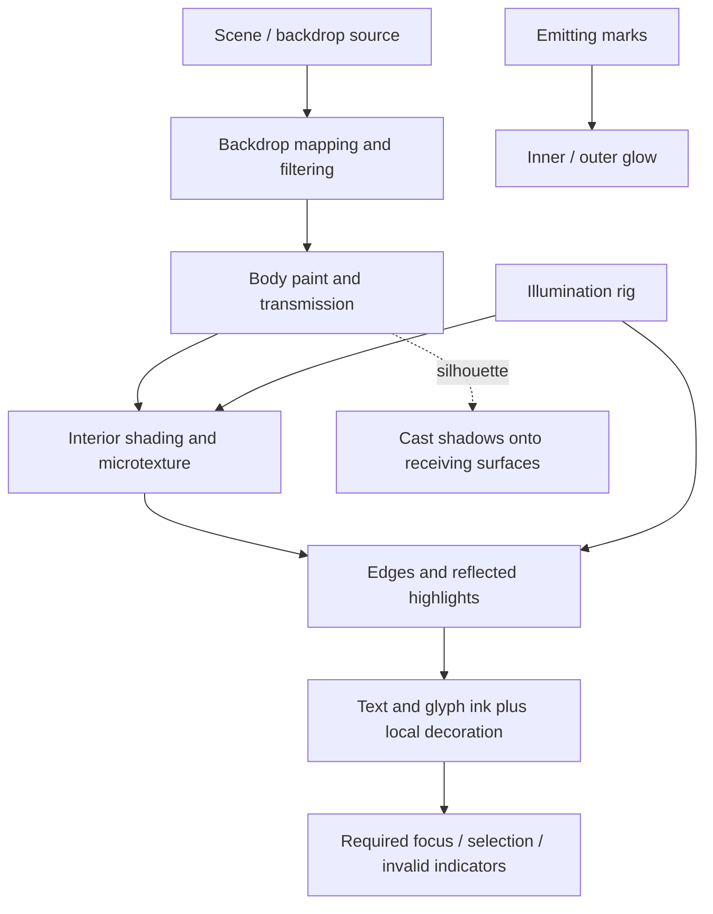

# Shared material layer model — research vocabulary v1

**Status:** proposed common vocabulary for materials tasks 02–14; unreviewed. This is a descriptive model, not new tokens, CSS, a renderer, or a change to component approval. It refines the [owner’s vocabulary](https://github.com/ethanwongwork/area/blob/832057ba7d302bd1a245c31ee5402f2dec1fe647/docs/research/astra/materials/README.md#L50-L62). That link pins research-brief provenance; all claims about implemented Area behavior below pin `origin/main` separately.

## Separate the names before combining their layers

The following distinctions are **Astra’s proposed analytical vocabulary**. The [catalogue](catalogue.md) provides the sourced definitions that motivate it.

- **Primitive:** an operation or paint, such as gradient, inset shadow, glow or grain. It says how some pixels are produced, not what the component is made of.
- **Material recipe:** a coordinated optical treatment of a role: body paint, backdrop response, edge, shading and texture. Paper, acrylic and soft plastic are useful material-level descriptions. Named platform materials also carry behavioral rules.
- **Finish:** how the modeled surface reflects light: matte, satin or gloss. Record highlight extent, sharpness and strength explicitly; the finish label is not a numeric preset. A glossy opaque body is possible, as is a translucent matte one.
- **Visual language:** an art-direction package spanning materials, imagery, typography, geometry and motion. Aqua and Frutiger Aero belong here; a paint recipe cannot reproduce their entire language. Flat describes a modeling approach. Skeuomorphism describes a relationship to a recognizable predecessor.
- **Preset:** a named bundle of recipes by role, with declared context and fallbacks. A preset can mix a frosted floating surface with opaque rows and plain text. It is not permission to apply all effects to every component.

Use explicit names rather than the ambiguous word “material” for all five levels. Capitalized **Material Design** identifies Google’s system; lower-case **material recipe** is this series’ generic concept.

## The record every later task should use

Proposed identity: **recipe / role / part / state / context / evidence**. Preserve these fields even when the renderer changes.

**Role and part.** Keep the brief’s page, container, floating surface, raised control, recessed field/track, thumb/knob, indicator, divider, glyph and text. They describe where a treatment belongs. Split “role” into structural purpose and relief when necessary: a field need not always look recessed. Record the component part separately, so a Slider track and Slider thumb can use different recipes. Full family mapping belongs to task 04.

**Context.** Carry theme, density, semantic tone, action/selection emphasis, accessibility preferences, interaction state and the scene behind the part. These are inputs, not new material presets. Geometry includes the existing shape, radius, mask and layout bounds; a layer must name its clip rather than silently enlarge or shrink the control.

**Optical and paint channels.** These map directly to the requested matrix while adding the missing backdrop/lensing distinction:

| Matrix field | Canonical record field | What must be recorded |
| --- | --- | --- |
| Fill | `body.paints[]` | Ordered paints: solid, image, linear/radial/conic gradient, mesh; colors/stops or control points, coordinates, interpolation space, alpha and blend |
| Translucency | `body.transmission` | Backdrop participation; keep body paint alpha separate from group opacity and effect alpha |
| Blur | `filters[]` | Target: backdrop, body, shadow, emission or texture; order and amount; never one global “blur” value |
| Stroke model | `edges[]` | Geometry/placement/mask, width, paint and alpha; distinguish decorative edge from required state/focus edge |
| Highlight | `reflection[]` | Mask, paint, extent, softness and light/environment dependency; rim highlights are a subtype |
| Inner shadow | `shading.inset[]` | Occlusion/relief intent, clipping, offset, spread, softness, color/alpha; a renderer may also use inset primitives to implement highlights |
| Drop shadow | `shading.cast[]` | Receiver, silhouette, offset, spread, softness and color/alpha; multiple lobes allowed |
| Glow | `emission[]` | Emitting mark, inner/outer mask, color, strength, spread and falloff; independent from reflected highlights |
| Grain | `texture[]` | Source/distribution, scale, strength, seed, blend, clip and whether time-varying; not a mandatory paper/glass ingredient |
| Text treatment | `content.ink` and `content.decoration[]` | Semantic foreground plus optional glyph-local relief, shadow or emission; keep readable ink separate |
| Depth | `spatial.relationship` and `spatial.relief` | Parent-relative recessed/flush/raised/floating relationship plus modeled profile; neither is the DOM stacking order |
| Light direction | `illumination` | Key-light direction/height, ambient term, environment/reflection source and emission sources; orientation is not a gradient-stop parameter |

**Backdrop acquisition and mapping:** `backdrop.source` distinguishes none, local content, behind-window content, wallpaper and an environment reference. `backdrop.mapping` distinguishes unchanged sampling from displacement/lensing. Filtering, tinting and mapping are different operations. Retain a source's own name if its internals are undisclosed; do not fill an unknown field with zero. Microsoft’s [Acrylic](https://learn.microsoft.com/en-us/windows/apps/design/style/acrylic) and [Mica](https://learn.microsoft.com/en-us/windows/apps/design/style/mica) demonstrate why source and transmission must be separate (checked 2026-10-07).

**Behavior:** `adaptation` describes what changes with backdrop, size, focus, motion or input. `fallbacks` identifies a tested simpler recipe and the condition that selects it. An optical snapshot cannot stand in for a behavior specification. Apple’s [Liquid Glass](https://developer.apple.com/videos/play/wwdc2025/219/) includes dynamic lensing and environmental response; its exact internal constants are not supplied by that session (checked 2026-10-07).

**Evidence:** each value records its URL/date or pinned source line, whether measured, specified, owner-supplied or inferred, and the scope in which it applies. Optional, absent and unknown are different states. Numerical values absent from evidence remain unspecified until a later task measures or proposes them.

## A compositing graph, with a readable default order

This is a **proposed logical decomposition**, not a claim about native CSS paint order. A renderer must preserve explicit masks, blend operations and dependencies. A shadow can fall on another object, and a highlight may span an edge and body; one universal list of CSS properties cannot express every case.

For a simple isolated panel, describe its surroundings and cast shadow first, then its transmitted backdrop and body, interior shading/texture, edge/highlight, content, and required interaction marks. Grain can be below gloss or above it depending on the intended surface; record the choice. Shadows and emission are branches with receivers/masks, not compulsory body coats. Some platform compositions need more than this default order.

This separation is consistent with alpha compositing and the distinction between background, outer shadows and inset shadows in the [W3C compositing](https://www.w3.org/TR/compositing-1/#simplealphacompositing) and [box-shadow](https://www.w3.org/TR/css-backgrounds-3/#box-shadow) definitions. The [backdrop-filter draft](https://drafts.csswg.org/filter-effects-2/#BackdropFilterProperty) describes backdrop processing and clipping separately from drawing an element and its children. It is **work in progress**, not proof of browser support (all checked 2026-10-07).

## Corrections to the seed vocabulary

1. **Lighting is a rig, not “everything follows one angle.”** Recommend a consistent key light for modeled relief, with ambient light, reflections and emission described separately. A luminous indicator radiates from its own shape; its glow need not point away from the key light. Environment-responsive materials may intentionally use changing lights. This is a proposed design rule, not a physics simulation requirement.
2. **Depth has separate meanings.** Cast lift, local convex/concave relief, background transmission and stacking order are not interchangeable. A translucent flush pane has transmission without elevation; a grain field has visual texture without geometric relief.
3. **Edges combine geometry with paint and modeling.** “Top only” is coverage; “double rim” is a collection of edges; “gradient” is paint; “bevel” is a profile/shading treatment. They are not mutually exclusive enum values. A bevel may use a gradient rim and an inner shadow together.
4. **A gradient is not automatically light.** Record whether it is color decoration, reflection, body shading, transmission tint or emission. A radial purple fill can mimic bloom without placing any glow outside the shape.
5. **The renderer primitive does not determine intent.** A spread-only shadow can draw a ring; a light inset effect can model the lit edge of a convex body. Keep `intent` alongside the rendering mechanism so task 03 can choose an implementation without changing the vocabulary.
6. **Finish is not opacity.** Matte/gloss and opaque/translucent are independent descriptions. “Frosted” additionally describes backdrop scattering; it should not silently turn the text blurry.
7. **Text is its own receiver.** Letterpress, glowing ink and body relief are independent. Never inherit a panel’s decorative blur onto its content merely because both belong to one recipe.

## Exercise against the brief, without inventing a capture

These are **inferred decompositions of owner-written descriptions**, not image measurements. The brief explicitly says the images are unavailable. Its research-branch provenance is [board items 5–6](https://github.com/ethanwongwork/area/blob/832057ba7d302bd1a245c31ee5402f2dec1fe647/docs/research/astra/materials/README.md#L82-L92).

- **Light button, item 5:** the `#E3E3E3` body at 80% is body alpha; the fading gradient belongs to an edge. Separate the soft external shadow from the zero-blur, zero-offset expanded ring. Classify the latter as an edge even if a renderer uses `box-shadow`. No backdrop blur, stroke width or gradient angle should be invented from that description.
- **Dark button, item 6:** its white-alpha gradient lies over an opaque `#1D1F23` base, so that composition does not make the entire button translucent. The top-only white stroke is separate from the external dark ring and soft shadow. The text’s shadow belongs to `content.decoration`, not the control’s elevation. Gradient angle and stop positions remain unspecified.
- **Track and thumb, item 10:** assign recess to the track, modeled lift/gloss to the thumb, and state-dependent ink to content. That is several role recipes within one component, not a single background pasted onto the whole control. [Brief provenance](https://github.com/ethanwongwork/area/blob/832057ba7d302bd1a245c31ee5402f2dec1fe647/docs/research/astra/materials/README.md#L100-L104).

These examples test vocabulary coverage. They do not adopt the board values as Area defaults.

## Area ownership boundary

**Observed:** Surface owns `--area-border-width`, `--area-shadow-1` through `--area-shadow-4`, `--area-shadow-card` and `--area-shadow-float`. Its Flat preset removes shadows but retains a decorative border. Thus “strict flat” in this taxonomy and Area’s named Flat preset are related but not identical contracts. [Surface lines 21–40](https://github.com/ethanwongwork/area/blob/4c1854202a8e109479d5b83ef24a8325231da056/packages/tokens/src/axes/surface.ts#L21-L40).

**Options:** extend Surface to include all material controls; replace it with a larger material axis and migrate consumers; or retain it beside new optical inputs and derive their interactions. **Recommendation:** the third option. Keep Surface the sole writer of its existing namespace. A future material namespace would own only new optical inputs such as backdrop treatment, body paint structure, reflection, emission and texture. Decorative border width and cast-elevation policy continue to come from Surface. Use `emit/base.ts` for derived combinations, re-emitted at scope boundaries; never let two axes write a shared token. This obeys the existing [namespace/derivation rule](https://github.com/ethanwongwork/area/blob/4c1854202a8e109479d5b83ef24a8325231da056/docs/DESIGN_SYSTEM.md#L20-L27), but is not an approved schema.

The difficult boundary is **intrinsic relief versus elevation**. Proposed inset modeling and specular edges describe an object's surface; `shadow-float` describes its relationship to surrounding content. If a neumorphic/clay recipe needs an external relief lobe while Surface is Flat, do not silently bypass Flat. Mark the pairing incompatible, simplify the recipe, or seek an explicit Surface contract revision in task 07. Do not create a second shadow ladder under another name.

Required identification/focus edges remain outside decorative material edges under [CONTRAST lines 25–53](https://github.com/ethanwongwork/area/blob/4c1854202a8e109479d5b83ef24a8325231da056/docs/CONTRAST.md#L25-L53). Preserve action/selection and semantic-tone ownership under [THEMING lines 36–68](https://github.com/ethanwongwork/area/blob/4c1854202a8e109479d5b83ef24a8325231da056/docs/THEMING.md#L36-L68). Material animation cannot authorize a hover foreground change or weaken contrast floors. Dark defaults remain near-black, as [DESIGN_SYSTEM lines 272–278](https://github.com/ethanwongwork/area/blob/4c1854202a8e109479d5b83ef24a8325231da056/docs/DESIGN_SYSTEM.md#L272-L278) specifies.

Use the [Reference baseline](https://github.com/ethanwongwork/area/blob/4c1854202a8e109479d5b83ef24a8325231da056/docs/research/BASELINE.md#L1-L25) and existing [Button](https://github.com/ethanwongwork/area/blob/4c1854202a8e109479d5b83ef24a8325231da056/docs/specs/button.md#L1-L7) / [Slider](https://github.com/ethanwongwork/area/blob/4c1854202a8e109479d5b83ef24a8325231da056/docs/specs/slider.md#L1-L8) evidence as the unchanged starting point for later role studies. A glossy Button or recessed Slider track would be a proposal requiring new evidence, not a correction inferred from a trend name.

## Handoff contract for the series

Task 02 should classify products by primitive, material recipe and complete role preset separately. Task 03 should attach rendering mechanisms and tested fallbacks to this record; task 04 should supply component-part/role mappings. Tasks 05–14 should preserve these field meanings while studying absorption, measured values, controls, accessibility, dark/density, states, performance, text, presets and tooling respectively. If a later task needs a missing channel, record the change to this vocabulary rather than making a competing definition in that report.
