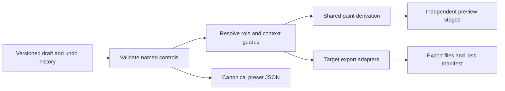

# Gallery material builder proposal

Everything below is **proposed behavior**, not an implemented gallery or calibrated UI design. The [brief and task 07](evidence.md#research-inputs) supply the control/ownership contract; the current gallery only writes its registered theme, density, radius and pill selections on the canvas and saves them locally. Its chrome remains outside that selection. Current Theme accepts axis selections and pills, without the proposed material controls. [A01–A03](evidence.md#area-snapshot).

## A user flow through the gallery

1. Open **Materials** beside the existing Theme controls. Choose a preset from 13 or “None.” Keep Mode, Density, Radius, Pills and Surface separate. Start with the current canvas configuration, not a second invented set of theme defaults.
2. Choose **Whole gallery**, **Selected family**, or **Role samples**. Begin with the selected family's real demo source. Each tile still shows one variant and one size. A role sample is labelled as a diagnostic, never substituted for a real component.
3. Edit the global light/body/edge/relief settings. The selected stage updates from one validated draft; the builder chrome keeps its ordinary appearance and accessible focus. A displayed control indicates “Inherited,” “Overridden,” or “Limited here.”
4. Select a visual part through an optional inspection mode or a keyboard-accessible parts list. Read its role, parent relationship, Surface tier and optical owner. Choose a role override rather than silently creating a per-component recipe. An arrow aliased to its Popover points to that shared shell.
5. Turn on **Before / After**. Before starts at Material None while retaining exactly the same other axes, fixture content, viewport, scroll position and state; “Pin current as Before” stores an explicit immutable baseline. After follows the draft. On narrow screens use a labelled toggle, preserving the same fixture position.
6. Inspect the change summary, use Undo/Redo or Reset role, then **Download preset JSON**, **Copy link**, or **Export**. Export first previews target capabilities and losses; it does not silently publish or modify a Figma document.

A pinned baseline and a draft are separate records. “Reset preset” discards its override patch; changing to another preset also clears that patch by default, with an explicit “Keep compatible overrides” action that lists any rejected fields. No direct DOM style scraping becomes the source document.

## Live controls

Use task 07's groups with a numeric field alongside continuous controls; discrete topology choices use selects. Keyboard editing must offer the same values as pointer dragging. Describe units and the key-light convention in help text. Preview adjustments do not change product settings or component specs.

| Group | Controls | Feedback on the selected receiver |
| --- | --- | --- |
| Preset and amount | Named profile; None/Trace/Quiet/Full cap | Requested versus effective cap and guard reason; never an “intensity percentage” that multiplies all channels. |
| Lighting | Key angle, height, ambient | One shared scope light; cast direction can stay source-authored. No accidental RTL light flip. |
| Body | Semantic tint source, transmission, acquisition source and blur | Editing opacity affects paint only; show the opaque reading island and acquisition owner. |
| Relief and cast | Convex/concave, local depth/softness/spread/strength; Surface gains and direction separately | “No cast on this role” remains effective even if a stored cast gain is nonzero. |
| Edge | Coverage, solid/gradient, plain/bevel/double rim, opacity | Width belongs to Surface; focus/invalid/required edges bypass decoration. |
| Gradient | Named layer, kind, angle/coordinates, ordered stops, source and alpha | Stable stop IDs; explicit light/dark decorative pair; display geometry and interpolation. |
| Emission | Inner/outer/both, strength, semantic source, softness/spread | Separate core and halo; no expansion of truthful data fill. |
| Texture and reflection | Grain strength/scale/seed/source; gloss strength/extent/softness/source/mask | Static grain, one phase per shell, content-exclusion mask status. |
| Role overrides | The same permitted leaves for any of twelve roles | Clear means inherit; zero means off. Light changes require a nested scope, not twelve contradictory lights. |

Initial ranges come from profile metadata after calibration. Do not invent safe blur limits or label task 13's trial seeds “recommended settings.” Out-of-domain input is rejected with the last valid preview retained; a valid but suppressed request remains stored. Required state behavior, typography and layout do not become material controls.

## Before/after that tests the actual problem

Render sibling, independently scoped stages from the **same demo model and source**. Give duplicate fixtures unique IDs and separate overlay destinations; portal content receives the matching stage Theme/control context. A changed right stage must not recolor left-stage portal content. Side-by-side means two live previews, not one global root toggle. Do not let the before stage inherit after-stage custom properties.

Expose scripted scenario selection: rest, hover, pressed, focus-visible, selected/checked, open, disabled, invalid and combined invalid+focus. Label simulated states and keep a separate real keyboard interaction mode; a synthetic `data-*` flag is not evidence of native keyboard or focus behavior. Reuse existing fixtures/manifest state hooks where documented, rather than broadcasting new arbitrary state attributes. The manifest declares variants, elements and state exceptions, but has no material-role bindings yet. [A06](evidence.md#area-snapshot).

Show compact/default and sm/md/lg as separate tiles; offer a dense Table/Code/Message, Calendar range, Slider, InputGroup and popup scene. Backdrops include reproducible flat and patterned fixtures with IDs. Glass in glass and recess in raised have dedicated composition scenes. Light/dark are real theme scopes; no CSS invert filter. Current gallery theme changes deliberately force a restyle, so the future stage adapter must preserve verified color re-resolution without hiding/repainting unrelated chrome. [A02](evidence.md#area-snapshot).

A **Check readability** action reports tested combinations and untested ones. It does not show a global green WCAG badge from a single static color pair. Contrast testing remains additive to Area's current gates; opaque fallbacks, worst-case composed backdrops and preference behavior are inherited from 08. A diagnostics view shows acquisition count and active effects on the selected scene, not a universal performance score. Freeze animation and randomness for comparisons; treat actual performance measurements as a separate run with an explicit browser/device description.

Accessibility controls in the builder simulate fallbacks only inside the stage and must be labelled simulations. OS forced-colors/reduced-motion remain honored. Display effective fallback and suppression reason; do not let an inline requested value defeat it. Tab order and screen-reader labels in the chrome survive every material selection. Announce validation results on commit, not every pointer movement.

## Data flow and integration work

The left stage uses its own pinned draft through the same pipeline. A future compiler resolves structural choices once and updates allowed numeric leaves for live editing. Apply at most one paint update per animation frame; record one undo transaction per drag/committed text edit, not a history entry per pointer event. These are scheduling proposals, not measured latency claims. Keep expensive static grain generation outside a frame's paint update and cancel stale asynchronous compilation results using draft revision IDs.

Add a typed Material builder state beside the gallery's present string-only selection map. Preserve existing saved Theme preferences; save drafts under a separate versioned key. Restore only after schema/version validation. Do not add continuous Material objects to `GALLERY_CONTROLS.items` or stringify them into `data-area-*` attributes. Reuse 07's typed props and a scope marker; the actual React/control API is future work. [A01–A03](evidence.md#area-snapshot).

Use the role companion bindings proposed in 07, checked against the manifest. Current scope derivation is emitted at axis/contrast boundaries, so new control-only and semantic painted-part boundaries need explicit re-emission from the shared generator. Do not copy formulas into gallery CSS, use docs overrides of `.area-*`, register derived colors, or make the gallery a second renderer. [A05–A08](evidence.md#area-snapshot).

## Shareable JSON and links

The canonical document is a **requested recipe**, with schema version, profile/compiler/policy revisions, provenance, both modes, global controls, role overrides and named layers. Keep source selectors symbolic until a target context resolves them. An optional preview block carries public fixture IDs and axis choices; it is not component data. No generated computed colors replace semantic references.

Offer two transports:

- **Portable JSON download (default):** selected recipe snapshot plus typed override patch, content hash and immutable policy/compiler requirements. Embedding the recipe prevents later preset-library edits from changing a saved design. Include a human label and descriptive metadata outside the hashed payload. The sample [shared preset](examples/material.area.json) demonstrates this with Glass from 13.
- **Copy link:** encode a versioned small selection/patch in a URL fragment against an immutable bundled preset revision. If that revision is unavailable or the link exceeds a tested transport budget, offer the JSON file instead. Do not promise a universal URL size. A short hosted link would need storage, retention and access policy, so defer it; never upload just because Copy link was clicked.

Fragment parsing runs before applying the draft. Imported data is data: no JavaScript, raw CSS, HTML, arbitrary selectors or external SVG/filter URLs. Validate finite numbers, type/units, known keys/roles/layers, stop order, alias cycles and supported revisions. Reject duplicate keys during parsing, dangerous object keys, excessive nesting/size and unknown executable assets. Show an import diff, retained unknown metadata, and required migrations; reject unsupported semantic fields rather than silently ignoring them. External token refs are restricted to the chosen bundle, not automatically fetched. These are format-specific validation requirements, not extra user approval steps for ordinary local edits.

Canonical JSON serialization uses a versioned rule; hashes identify content, not authority or visual approval. Our fixture uses a declared sorted-key UTF-8 serialization for an integrity example, not a claim of an existing RFC-compliant Area signing format. Export/import should preserve requested overrides and stable layer IDs exactly. Resolved values, test results and export loss records are separate outputs and cannot be imported as approval evidence.
