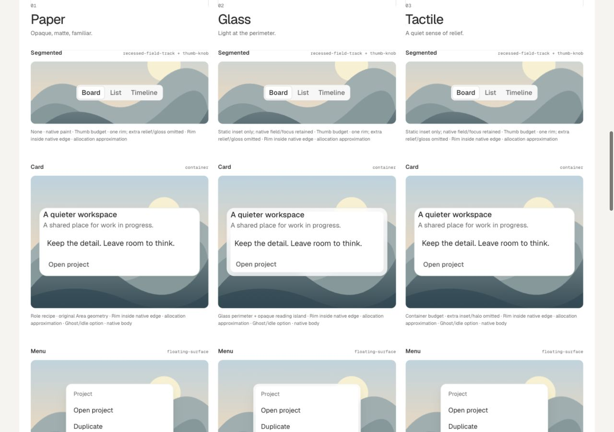
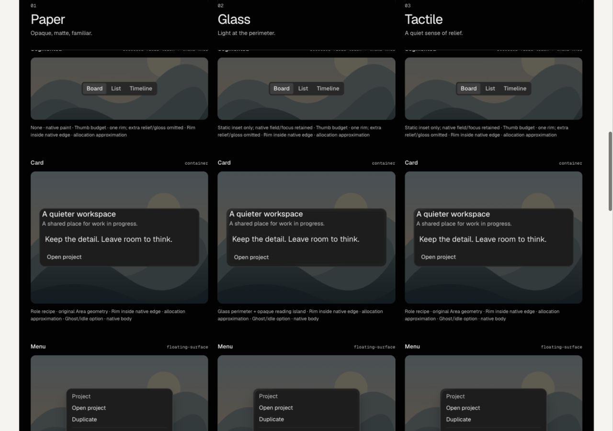

**Question:** How do Paper, Glass and Tactile from task 13 look on the same compiled Area components across mode, density and backdrop, and which requested recipes cannot be rendered faithfully within the research folder?

**Answer:** Built a static comparison with **288 tiles**: three presets × eight contexts × twelve examples.
It uses Area's compiled CSS and component markup, with all material additions scoped to this folder.
**39 live controls, including 28 sliders**, edit a material globally or by role; reset restores its exact task-13 records.
Paper preserves ordinary surfaces; Glass transmits around an opaque reading island; Tactile models eligible rims and wells.
Shadow budgets, thumb limits, dense reading planes and unresolved edge allocation prevent a literal rendering of every request.
Those reductions and remaining gaps are explicit in [limitations.md](limitations.md); this is an unapproved research specimen.

**Snapshot:** Checked **2026-10-10**. Area `origin/main`: **eaa9222ebf98f7c260f9e0dd448940523003d4d3**. Research/preset input: **b372cc6cc7fe3427c99898e8f7944facadfb2be2**. Read the materials brief, 05, 07 and 13; used 11 and 15 to interpret conflicts. `npm run build` succeeded in the main checkout; the research checkout serves that checkout's `packages/styles/dist/area.css` directly. CSS SHA-256: `696593187549339ac82234d4bf7a682306901d49a88730c4c817d0a73c35e76d`. Source pins are in [evidence.md](evidence.md).

## Open and reproduce

The running specimen is [http://127.0.0.1:8767/16-specimen/](http://127.0.0.1:8767/16-specimen/). It requires the local server; opening HTML with `file:` does not resolve the root-relative compiled CSS URL.

From an Area checkout at the pinned main commit:

```sh
npm run build
```

From this research checkout, pass the path to that built checkout (the option defaults to the current repository when it contains the appropriate build):

```sh
node docs/research/astra/materials/16-specimen/build.mjs --area-root /Users/ethanwong/Desktop/area
python3 docs/research/astra/materials/16-specimen/serve.py --area-root /Users/ethanwong/Desktop/area
```

The server binds loopback only. It exposes the materials research tree, the compiled CSS and Area's capture script; it does not start the gallery, use a product account or fetch external assets. The source preset data is copied exactly into [preset-data.js](preset-data.js); edits are separate patches, never mutations of task 13. `index.html` is the requested static specimen artifact generated from the fixture source, not a copied package distribution.

Choose Appearance, Density and Backdrop, or show every context. Each context contains Paper, Glass and Tactile together, in that order. The examples are Button solid, Button ghost, Input, Switch, Segmented, Card, Menu, Popover, inline Dialog, Toast, Table and Code block. Size-aware fixtures use `md`; default/compact are genuine Area UI scopes. Surface stays Outlined and radius stays 8 throughout this comparison, deliberately isolating the requested axes. The image is an original local SVG landscape, with a separately authored dark scene wash; it is not a measured product capture or photograph.

“Adjust material” exposes shared lighting, intrinsic relief, eligible Surface cast gains, transmission/blur, edge, gradient stops/angle/colors, glow, grain and gloss. “All eligible roles” shows the floating-surface seed as an editing starting point, **not** a claim that all role defaults are identical. Only edited leaves propagate. A selected role overrides those edits; lighting remains shared. A blocked channel stays blocked. Reset clears the selected scope, and “Download draft” exports source records plus patches as a lab document, not a production Theme API.

## Evidence and checks

[verification.json](verification.json) records all **480 optical receivers** across the 288 tiles, effective channel decisions, context IDs and four verbatim `areaCapture.capture()` records. Nested buttons and Switch/Segmented parts explain why receiver count exceeds tile count. With all contexts displayed, the on-page check found zero duplicate IDs, zero component width/height or computed foreground differences between material paint and plain fallback, and zero transmitting receivers remaining in fallback. It compares the two lab presentations; it is not a full pixel comparison against an untouched application.

[verification.md](verification.md) records browser interactions and test results. The existing **24,251 token tests** and **464 contrast assertions across 66 themes** passed unchanged. They test Area's token contracts; they do **not** certify these translucent image-backed compositions. Full composed contrast, native preference execution, Safari/Firefox, assistive technology and production overlay behavior remain unverified.

Recheck static consistency without writing outputs:

```sh
node docs/research/astra/materials/16-specimen/build.mjs --area-root /Users/ethanwong/Desktop/area --check
node docs/research/astra/materials/16-specimen/check.mjs
```

For fresh browser evidence, open the page at its unmodified defaults, choose “Run specimen checks,” then “Download audit.” The check temporarily reveals all contexts, compares material and plain paint, captures four representative receivers, and restores the selected view. Save that download as `verification.json` only when intentionally replacing the dated evidence. Every committed file is below 1 MB. No package source, earlier research folder, generated package distribution or existing test was changed.





## Proposals

**Recommend keeping this bounded renderer as a review instrument.** It makes the gaps visible without pretending the proposed axis, role bindings or masks already exist in Area. Accept the role budgets and edge allocation before translating it into production. A future implementation should give each component explicit content-exclusion and optical-owner parts rather than infer them from padding.

An alternative is to reproduce task 13's requested stacks literally. That would make Tactile more pronounced but would knowingly exceed the later lobe/thumb budgets and retain the inconsistencies found in task 15. This specimen chooses the bounded interpretation and reports the difference.

## Open questions

- Should one paired inset treatment count as one effect or two lobes on ordinary fields, and is raised-control relief explicitly admitted by task 11?
- How should an optional rim share a component's existing border allocation without painting a second inset ring?
- Which content masks and backdrop cases should be approved before Glass can leave this experimental page?
- Are the conservative Tactile reductions visually sufficient, or should the owner revise the earlier budgets? Nothing here changes those reports or confers approval.
