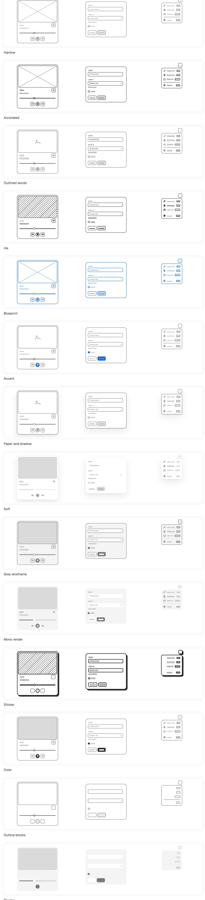
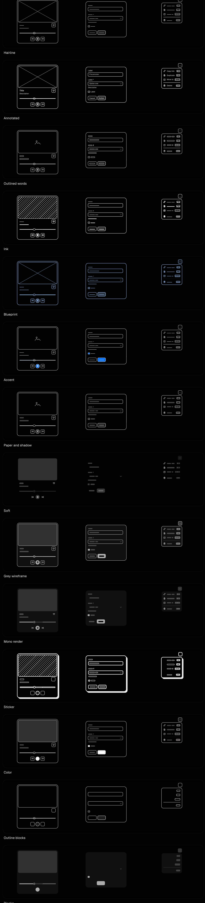
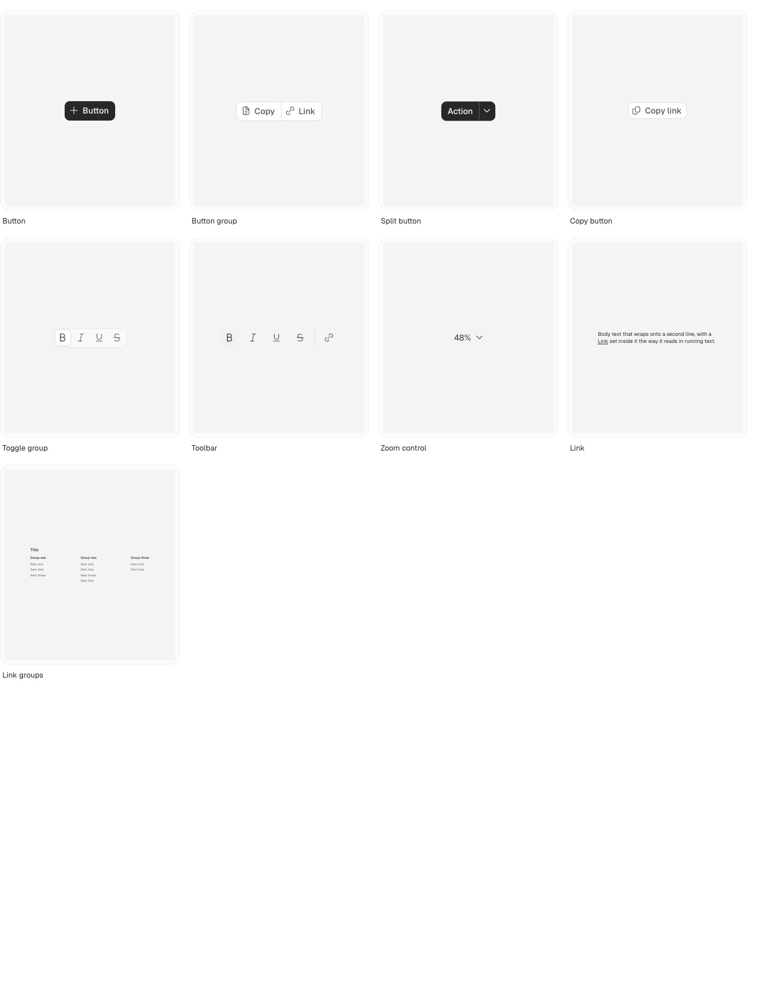
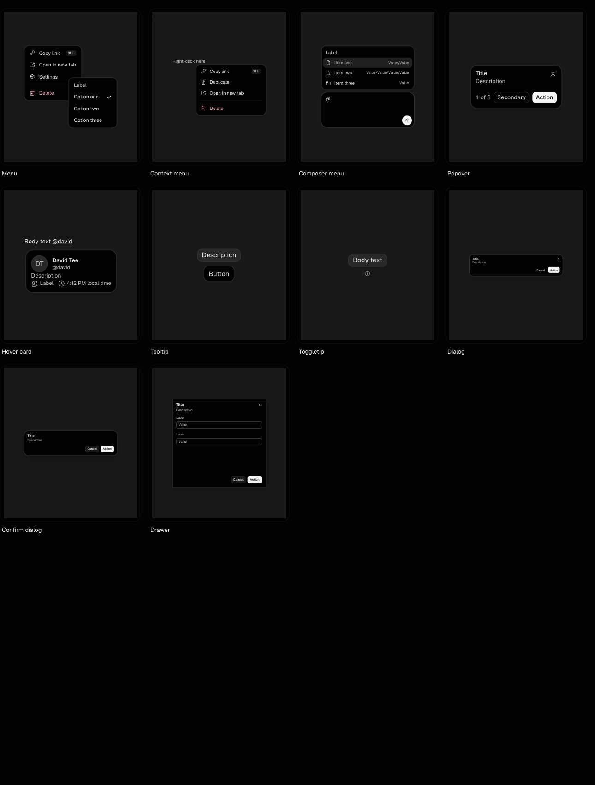
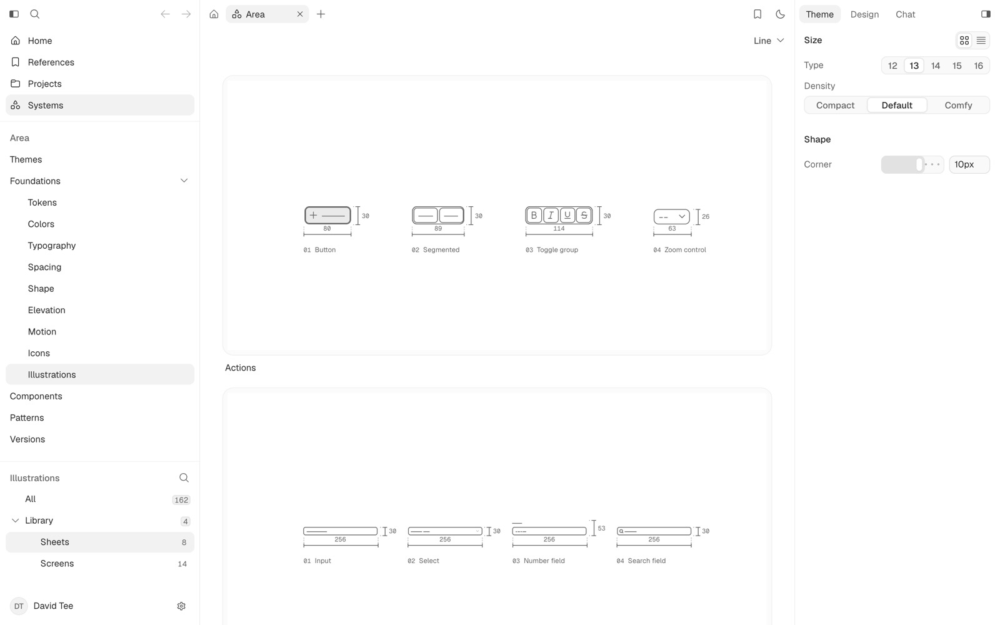
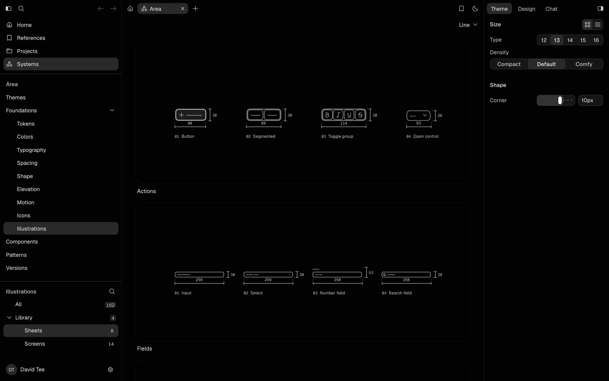
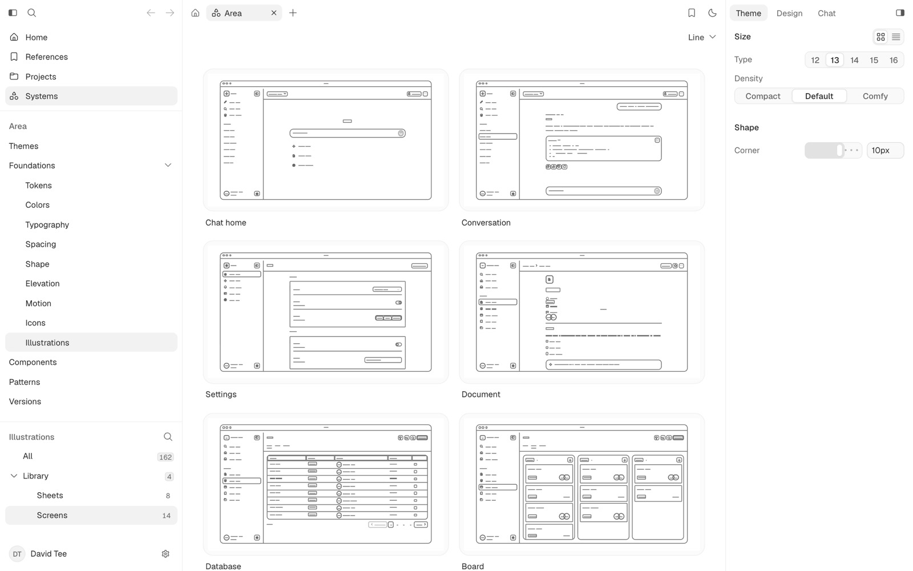
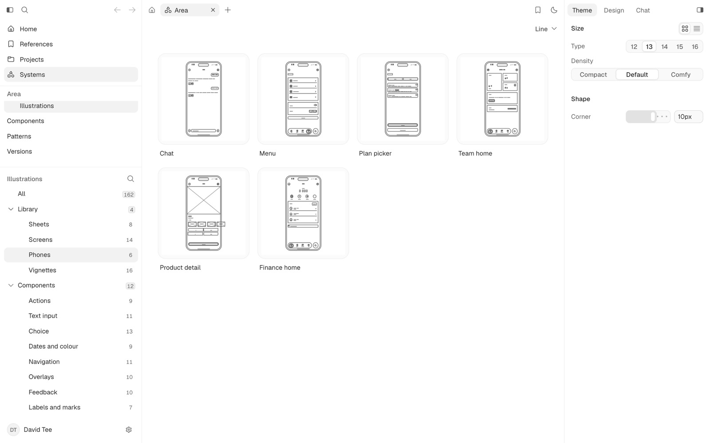
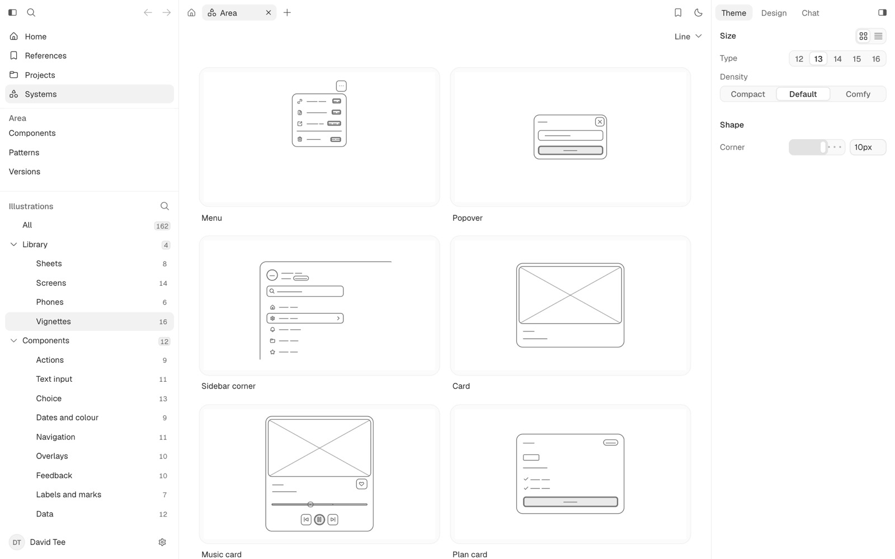
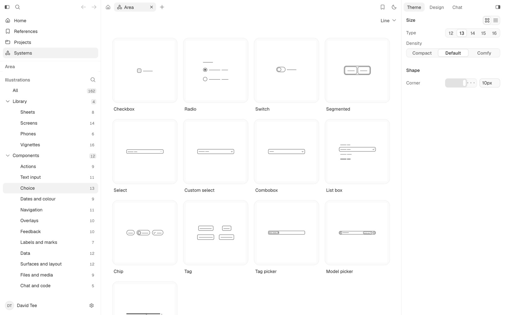

# Illustrations: the Line drawing (2026-11-04)

Owner, 2026-11-04: "i want to work on the library of abstract ui again, put these under 'illustrations' under areas
system. i want to establish a cohesive, consistent style that is visually appealing and high fidelity. im really liking
the last few line art examples showing cosmetic products." The app's Illustrations page (`#system/area/illustrations`,
under Foundations after Icons) shows the library in the new house style, **Line**. Uncommitted as of 2026-11-04.

## What the references share

Measured with sharp on the owner's images (`references/`; 16–18 are the cosmetic line art the owner named):

| Reference | Ground | Ink | Line | Ink on the frame |
|---|---|---|---|---|
| ref-16 (product range, dimensions) | 252 252 248 | 138 137 135 | 1px | 1.6% |
| ref-18 (product line-up, numbered names) | 240 240 232 | 137 137 127 | 1px | 1.7% |
| ref-17 (dielines, text as ruled lines) | 236 236 236 | 51 51 52 | 1px | 7.2% |
| ref-15 (technical sheet, dimensions, details) | 244 244 240 | 26 25 24 | 1px | 3.9% |
| ref-13, ref-14 (exploded axonometric) | warm white | blue 53 70 148 | 1–2px | 5–6% |

So: one hairline at one weight; one mid-grey ink (about 54% grey) on a warm white; very little ink; no fills, shadows
or gradients; text drawn as lines; objects named with a number (`01. Moisturizer`) on one line under a shared baseline;
true dimensions drawn as dimension lines with ticks and dotted extension lines; type for notes small and plain.

## The Line drawing

Area's real components, drawn by the area-illustration engine (`engine/line.js` marks the parts, `engine/abstract.css`
`.af-line` draws them). Nothing is redrawn: a figure is the same markup as Bars and Real.

| Part | Drawn as |
|---|---|
| Ink | `--area-fg-muted` (the references' ~54% grey; the system's own muted text role, so it follows the theme, light and dark) |
| Line | exactly 1px on screen at any scale (`--af-line` = 1.04px ÷ zoom); icons' strokes too (`vector-effect: non-scaling-stroke`) |
| Edges | every border stays, at the line |
| Fills and shadows | gone; a part that painted only a fill or a shadow is drawn by its outline, following its corners |
| Strong fills | a control-sized part with a strong fill (a primary button, a checked box, an on switch) keeps a 14% tone of the ink, so what is on or primary still reads; a larger one (a bezel, a dark panel) is its outline alone |
| Dots | 8px or less: solid ink (status marks, a radio's dot, a tab's current bar) |
| Words | one rule each, its own width, at the x-height's middle (ref-17's text as lines) |
| Headings and figures | outlined at the cap height (large or heavy type), so a title still reads larger |
| Pictures | the box with a cross corner to corner |
| Pointer | outlined in the ink |

## Styles (round 2, owner: "show me a bunch of different styles, i dont like exploded views that much, prefer straight on, want to see a variety of fills, strokes, shadows, abstractness vs detail")

Line became eight independent axes on the stage (`data-af-*`, abstract.css), so a style is a value on each and any mix
works. The page's **Styles** section draws one sampler (a picture card, a form, a floating menu) in each of 16 styles;
the Canvas bar's **Style** menu applies one to the whole library; the Inspector's Theme view mixes the axes one by one
(the menu then says Custom). Exploded views were dropped.

| Axis | Values |
|---|---|
| Stroke | Hairline 1px · Regular 1.5 · Bold 2 · None |
| Ink | Muted · Strong (the text colour) · Accent |
| Fill | None · Paper (layers hide what is under them) · Soft (a light ink tone) · Tonal (each part a grey as far from the ground as Area's fill, made plain) · Color (Area's own) |
| Shadow | None · Soft (an even lift under raised layers) · Hard (an offset copy in ink) · Theme's |
| Words | Rules · Bars · Outlines · Words (real) · None |
| Detail | Full · No icons · Blocks (containers only) |
| Pictures | Cross · Glyph · Tone · Hatching |
| Accent | None · Primary (on and primary parts in the accent) |

| Style | Stroke | Ink | Fill | Shadow | Words | Detail | Pictures | Accent |
|---|---|---|---|---|---|---|---|---|
| Hairline | hair | muted | none | none | rules | full | cross | none |
| Annotated | hair | strong | none | none | words | full | cross | none |
| Outlined words | hair | muted | none | none | outlines | full | glyph | none |
| Ink | regular | strong | paper | none | rules | full | hatching | none |
| Blueprint | hair | accent | soft | none | rules | full | cross | none |
| Accent | hair | muted | none | none | rules | full | glyph | primary |
| Paper and shadow | hair | muted | paper | soft | bars | full | glyph | none |
| Soft | none | muted | soft | soft | bars | full | tone | none |
| Grey wireframe | hair | muted | tonal | none | bars | full | tone | none |
| Mono render | none | muted | tonal | theme's | bars | full | tone | none |
| Sticker | bold | strong | paper | hard | outlines | no icons | hatching | none |
| Color | hair | muted | color | theme's | bars | full | tone | primary |
| Outline blocks | hair | muted | none | none | none | blocks | cross | none |
| Blocks | none | muted | tonal | none | none | blocks | tone | none |
| Bars (October) | the earlier Bars drawing |
| Real UI | the components as they ship |

Seen: in dark, a soft shadow can't lift a layer off near-black, so Soft's raised layers step lighter instead; Paper and
shadow keeps its hairlines. Color looks close to Grey wireframe because the default theme's paint is neutral.

## The gallery (round 3, owner: "maybe can just rely on real ui, but scaled down to fit. with just plain neutral backgrounds. can i see what small versions of each component would look like? all the 'illustrations' would be presented just like first image if they were in a gallery")

The owner's first image (`references/ref-19.webp`, a product's gallery of shots) measured with sharp: cards 285 × 317
(9:10), 12 apart, four across, ground rgb(245 243 241) on a white page, no edge; each object centred with a wide margin,
a phone standing from the upper part of its card and running off the bottom.

| Part | Now |
|---|---|
| Style | **Real UI** is the page's default and first in the Style menu (the other 16 stay to compare) |
| Card | the app's gallery card (Asset card, name below, 8 in), 9:10, on the card grid (at least 260, four across) |
| Ground | the figure's own, part of the picture: `light-dark(oklch(0.966 0 0), oklch(0.21 0 0))` (the reference's lightness made neutral; dark a step above the near-black page). The engine's stage and component plate read it as `--af-stage-ground` |
| Components and vignettes | one shared scale, 1.1× at a 290 card (it follows the card), centred on what they paint; what doesn't fit in 70% (vignettes 66%) of the card shrinks; a field or slider takes a 180 measure |
| Screens | the desktop window in 74% of the card's width (about 0.22×) |
| Phones | 60% of the card's width, standing 14% from the top, running off the bottom |

Styles and Sheets stay wide comparisons.

Overlays are shown open (owner: "Yes, open them"): Toggletip by its open specimen; Hover card, Date picker and Date
range picker held open (`SHOW` `open`, abstract.css `.af-open`: the native popover drawn under its trigger at the 8
gap); Context menu as the real Menu at the pointer over its area (it renders rows only once opened). Fixed on the way:
a flex heading dropped the spaces between wrapped words ("Onthispage"), now one `span.tx-run` per run (markup.js); tabs,
steps and pagination take a 280 measure.

## The library (the page)

| Section | What | Frame |
|---|---|---|
| Sheets (8) | 4–5 families of one kind on one baseline, numbered and named under each, their true width and height as dimension lines (ref-16, ref-18) | full Canvas width, 5:2, up to 1.6× |
| Screens (14) | the skill's desktop screens | 16:9, 90% of the card |
| Phones (6) | the skill's iPhone screens | square, 88% of the card's height |
| Vignettes (16) | the skill's components in context | 16:9, the frame fitted |
| Components (119) | every family's first gallery specimen (or `SHOW`'s), by kind | square, centred on what it paints, up to 2.4× |

The Canvas bar's Drawing menu keeps Bars, Shapes and Real to compare. A sheet's notes are drawn in the card's own pixels
(1px lines, 9–10px type) and its values are the parts' painted size at true scale, measured, never typed.

## Visuals

## Open

- **Exploded views**: dropped (owner prefers straight on).
- **The house style**: Real UI, scaled down to fit, on a plain neutral ground (round 3); Line and the other styles stay to compare.
- **Paper**: the figure sits on the card's ground; the references' warmer paper would be a setting, not a fixed colour.
- Component tiles are near true size, so a checkbox reads small beside a toolbar; one scale per kind was kept.
- Setup's product screen still draws Real (`FIGURES` false in setup-screen.tsx, owner 2026-10-30); Line is the
  Illustrations page's.
