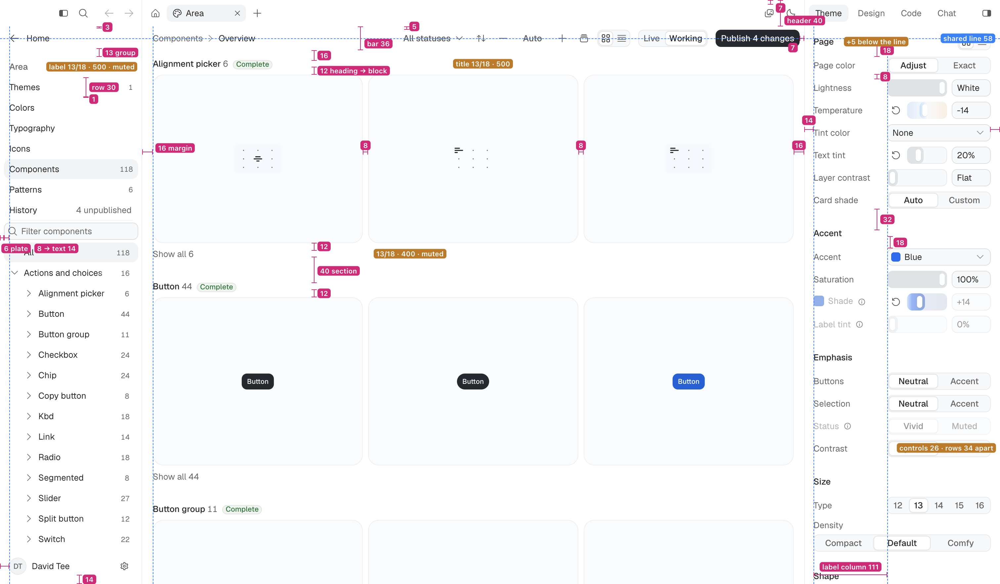

# Region balance: Sidebar, Canvas and Inspector across densities (2026-10-31)

The owner asked (2026-10-31): "has the spacing/layout/composition/rhythm and overall size balancing been addressed and
implemented? i like the size and padding/gaps of the top header, but want to see if the left panels, main canvas, and
inspector need padding/gaps/spacing/optical balance updates … mostly rely on the claude code and cursor references to make
sure the product itself is balanced and is properly documented in the density themes."

Earlier passes already settled the headers (40, the small control 7 in), rows (28 at Compact), the feed (2026-10-22 and
24), the vertical rhythm of text and chat (`vertical-rhythm-2026-10-30`, `feed-rhythm-2026-10-31`) and the Inspector's
grid (`inspector-panel-2026-10-30`). What none of them checked: how the three regions' insets and gaps behave across
densities, side by side.

## How it was measured

- **Area**: the Electron app built from this branch (origin/main aab776d6), 1512 × 884, DPR 2, the owner's system (type
  13, density 32), over CDP (`area-interaction-pass` › `scripts/cdp.mjs`); text measured cap to baseline. True density
  frames came from capture mode (`electron/main.cjs --capture --store='{"appLook":{"follow":false,"own":{"density":…}}}'`),
  which runs in its own storage partition and never touches the owner's systems. Flipping `data-area-density` on `<html>`
  gives hybrid frames: elements that stamp the app's committed scale (the Canvas path, section chrome) keep it.
- **Claude desktop** (Code tab) and **Cursor 3.27.22** (Agents window): read from their installed bundles only, every
  value below quoted from a CSS or JS string. Nothing was launched. Neither app's live window was measured.

## References (compact, px)

| Part | Claude Code | Cursor Agents | Area (type 13 / 32) |
|---|---|---|---|
| Sidebar width | 288 (200–420) | 260 (210–400) | 240 (200–360) |
| Row plates from the edge | 8 (`px-2`) | 8 (`--ui-sidebar-inset`) | 6 |
| Row text from the edge | 18 (8 + 2 + 8) | 14 iconless; label 40 after a 20 icon box | 14 |
| Rows, apart | 26 (28 in the Code list), 2 | 28, 2 | 30, 1 |
| Group label | 28 band, 12/16 regular muted, 10 above | min 30, 13/18, groups 16 apart | a row, 13/18 500 muted, 12 above |
| Header to first row | 4 (+4 with a search row) | the actions block, then the list | the first row centred on the Canvas bar's line |
| Footer | hairline above, 6–8 padding, a 28 account button | 8 padding | Panel's footer, 14 in, a 26 profile row |
| Content gutter | 32 (16 at ≤560; 24 with the side panel) | 16 inside a 780 column | 16 (a gallery that fills the Canvas) |
| Reading measure | 768 / 960 / 1280 | 780 | 768 (Settings, chat) |
| Side panel width | 280 fixed | 50% (min 384) | 256 (256–500) |
| Side panel text from the edge | headings 12 (8 + 4), rows 38 after icons | header 8; sections 8 + 4 | 14 |
| Side panel heading | 12/15 500 primary | 12/16 regular secondary | 13/18 500 primary |
| Density steps | pads 4/6/8/12/20 → 6/8/12/16/24; gaps 6/8/12/20/32 → 8/12/16/28/40; rows 26 → 32 | one density | rows and controls stepped; region insets and the feed did not |

Sources: Claude `ion/assets/v1/shared-styles-*.css` (`--df-row-h:26px`, `.dframe-sidebar-body … px-2 pt-3`),
`shared-18-*.js` (`_S=280`), `shared-6-*.js` (`--chat-gutter … 32px`); Cursor `workbench.glass.main.js`
(`SSe={defaultPx:260,minPx:210,maxPx:400}`, `bUn=780`) and its StyleX table (`--ui-sidebar-inset:var(--cursor-spacing-2)`,
`--ui-sidebar-group-gap:var(--cursor-spacing-4)`). The earlier token tables: `claude-code-ui-audit-2026-10-31.md`,
`inspector-panel-2026-10-30/`.

## The rhythm at the app's setting (type 13, density 32, 1512 wide)

Measured in the running app, text from its cap to its baseline, boxes from their edges. All text is one size, 13/18;
tiers come from weight (500 titles, 400 rows) and ink (muted labels, counts, "Show all", the path).

| Where | Space | Value |
|---|---|---|
| Every header | height; its controls (26) from top, bottom and sides | 40; 7 |
| Canvas bar | height; its controls from top and bottom; its start (the path) and end | 36; 5; 16 and 7 |
| Sidebar | plate from the edge; text in the plate; text from the edge | 6; 8; 14 |
| Sidebar | row; between rows; above a group label; header to the first row | 30; 1; 13; 3 |
| Sidebar | profile from the side and the foot | 14; 14 |
| Canvas | margin (sides; bar to the first title's cap) | 16 |
| Canvas | cards apart; a title's baseline to its cards; cards to "Show all"; "Show all" to the next title | 8; 12; 12; 40 |
| Inspector | text from the edge (both sides); the label column | 14; 111 (40% of the row) |
| Inspector | controls; rows apart (pitch 34); heading baseline to its first row; last row to the next heading's cap | 26; 8; 18; 32 |
| One line | the Sidebar's first row, the path and the Canvas bar's controls centre on 58; the Inspector's first heading on 63 | +5 (q-line) |

The ladder, smallest to largest: 1 (rows) · 7–8 (bar insets, cards, Inspector rows) · 12 (a title to its block) ·
13–16 (groups, margins, region insets) · 32–40 (sections). Each step is about 1.5 to 2.5 times the one inside it, so
groups read without lines.

## Findings

1. **Region insets and the feed held still while density moved everything else.** Panel's md inset was a fixed 14 (since
   round 2, 2026-10-09; its sm tier and every other spacing role read `ui-dense`), and the Canvas's margin, card gap,
   heading gap and section gap were fixed 16 / 8 / 12 / 40. At Comfortable the rows grew to 34 and controls to 34 inside
   Compact's room; at Compact the feed kept Default's 40 between sections under 28 rows. That breaks spacing rule 6
   ("a dense tool steps every role down together"), and it is what Claude Code doesn't do: its pads and gaps step with
   its rows.
2. **At the app's own setting, the regions are balanced and match the references.** Sidebar and Inspector text 14 from
   their edge (Cursor 14, Claude 12 to 18); the Canvas margin 16, a step past the cards' 8; the Sidebar's first row and
   the Canvas bar's controls on one line (58).
3. **The Inspector's first heading sits 5 under that line** (its text centred at 63, against 58), set by Panel's own
   heading air (8 above a 30 row). Recorded in PRODUCT_UI.md as a fact, never as a decision. Open: q-line.
4. **Row plates sit 6 from the Sidebar's edge; both references keep them 8 away** (owner pick of 2026-10-12, when the
   rows stacked Panel's 14 and their own 8). Open: q-plates.
5. Docs had drifted: app.css's header still said the Canvas margin was 32 and named a Titlebar; content.md said cards 12
   apart and a 1236 column.

## Built (2026-10-31)

| Role | Compact (28) | Default (32) | Comfortable (36) | Was |
|---|---|---|---|---|
| Region inset (Panel md, the app's `--_studio-inset`, the Titlebar's title start) | 14 | 14 | 18 | 14 at every density |
| Feed margin | 16 | 16 | 20 | 16 |
| Cards apart | 8 | 8 | 12 | 8 |
| Heading to block | 10 | 12 | 16 | 12 |
| Sections apart | 32 | 40 | 48 | 40 |

Values at type 13; at type 14 the inset is 16 / 20 and the margin 18 / 22 (they read `ui-dense`, which carries the type).
The inset keeps a floor of 14: Surface's md inset is 12 at Compact, which would hang list plates 4 from the edge.
`docs/THEMING.md` › "What density does to a screen" holds the table for every role.

Checked: at type 13 / 32, capture frames of Components and Home, light and dark, are pixel-identical before and after.
Compact and Comfortable change as the table says (measured over CDP at 12/28, 13/28, 13/32, 13/36, 14/32, 14/36, 16/36).

## Open, for the owner

- **q-line.** Put the Inspector's first heading on the shared line (58), as the Sidebar's first row is: needs a Panel
  option for a window-bar panel's first heading (the app can't restyle Panel, rule 13). Recommendation: yes.
- **q-plates.** Row plates 8 from the Sidebar's edge (Claude and Cursor) with the text kept at 14, which means 6 inside
  the plate instead of 8 (Cursor's own 6). Recommendation: try it; it touches Nav and Tree view inside a Panel.

## Built after the owner's picks (2026-10-31: "All four, recommended") and feedback

| Item | Built | Measured (type 13 / 32) |
|---|---|---|
| q-line | An Inspector view that opens on a section heading moves up by the difference (`InspectorView` marks `data-lead="heading"` from what it draws; app.css). The app's own wrapper, so Panel is untouched | the heading's row centred on 58, with the Sidebar's first row and the Canvas bar (was 63); 2 at Compact, 9 at Comfortable |
| q-plates | Panel hangs a list by its row pad, 6 (`--_panel-row-pad`), which the inset contract reads for Nav's and Tree view's sides | plates 8 from the edge, row and label text 14, the filter edge to edge with the plates |
| Divider over a section's list | 8 of air above and below the rule (the nav's list gave back 8, so the rule touched History's plate and the filter sat 4 under it) | 8 / 8, the filter 4 over its rows |
| Feed text inset | titles, ledes, tabs, Show all, the path and Settings' titles 4 in from the frames (`--_text-inset`) | text 20, frames 16 |

Tables and Home's ways to start a system: `../type-pass-2026-10-31/README.md`.
