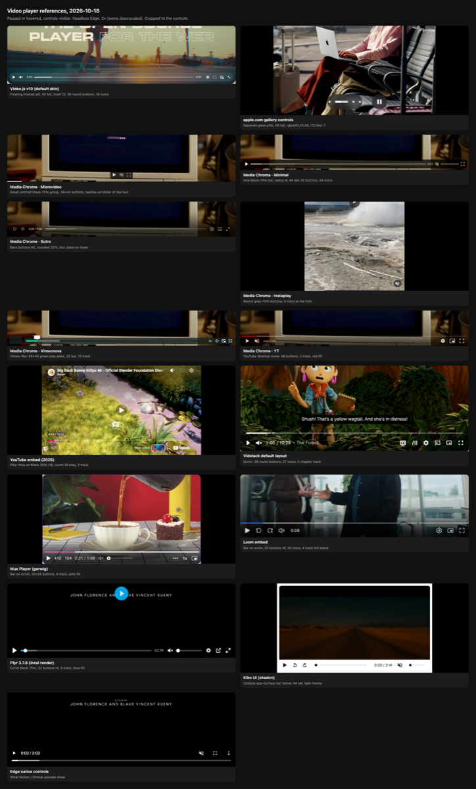

# Video player references, 2026-10-18

The owner reviewed the floating (QuickTime-style) player and asked: "refine the ui, what do other design systems and
products do?" This folder collects screenshots of public players with their controls showing, and computed styles read
from the same pages. It follows `../video-player-2026-10-17.md` (the first survey, mostly from source) and
`../video-player-quicktime-2026-10-17.md` (WebKit and AVKit). Values those notes already pin are not repeated here.

## Method

- Headless Microsoft Edge (`--headless=new`, a fresh temporary profile with sync and extensions off), driven over the
  DevTools protocol with Node's built-in WebSocket. Viewport 1280 × 900 (embeds 800 × 450), `deviceScaleFactor` 2.
- Each video was started muted through `Runtime.evaluate`, paused after about 4 s, and then hovered with
  `Input.dispatchMouseEvent` so the controls showed. Screenshots were clipped to the player. A few were downscaled to
  stay under about 600 KB (apple, youtube, vidstack).
- Computed styles were read with `getComputedStyle`, walking shadow roots for Media Chrome and Mux. Sizes are CSS px.
  On the reference pages the base type is 13–16 px, not Area's 13 Compact, so compare proportions as well as raw
  numbers.
- Nothing was logged in to or posted. Mux's cookie notice covered the controls. It was hidden with CSS, not accepted.
  YouTube refuses an embed that has no referrer (error 153), so it was loaded in an iframe on a local page; the same
  method was used for Loom.
- **Not captured:** Vimeo (headless was blocked: first "Rights issue", then "We couldn't verify the security of your
  connection"; not bypassed; the live values in the first survey stand). plyr.io now redirects to an unrelated sign-up
  page, so Plyr 3.7.8 was rendered locally from jsDelivr with Plyr's own demo clip. No public Notion page with an
  uploaded video was found. Notion and GitHub uploads use the browser's native controls, so Edge's native controls
  stand in for them (`native-edge.png`). The shadcn-style player is Kibo UI.

## Sources and readouts

### Floating panels (the closest to Area's `floating`)

| Source | File | Looks like | Measured |
|---|---|---|---|
| **Video.js v10**, default skin (videojs.org hero) | `videojs.png` | A **one-row frosted pill** over the video: play, mute, time, scrubber, remaining time, settings, cast, PiP, full screen | Pill **1156 × 44** in a 1180 player: inset **12** from the sides and foot. Padding **4**, radius **99px**. Paint `oklch(1 0 0 / 0.1)` (white 10%) under `backdrop-filter: blur(16px) saturate(1.1)`, plus `box-shadow: 0 0 0 1px oklch(0 0 0/.1), 0 1px 3px oklch(0 0 0/.15), 0 1px 2px -1px oklch(0 0 0/.15)`. Buttons **36** round (radius 99px), icons **18** with `drop-shadow(0 1px 0 oklch(0 0 0/.15))`. Scrubber hit 32, track **4**, thumb hidden at rest (opacity 0, 9.6 = 12 × 0.8). Time **13 / 400**, white 100%, `tabular-nums`, text-shadow `0 1px 0` black 15%. Elapsed on the left and **remaining** ("-0:31") on the right. No volume slider in the pill |
| **apple.com** gallery controls (macbook-pro) | `apple.png` | **Two separate glass pills**: a dot-nav pill and a round play/pause. Each control group gets its own pill | Pills **56** tall, radius 28: `rgba(42,42,45,0.72)` under `blur(7px)`. The play/pause plate is 56 round with a 28 glyph box. Inline clips elsewhere on the page use a **36** round `rgba(66,66,69,0.72)` button. Ink `rgb(245,245,247)` |
| **Media Chrome · Microvideo** (player.style) | `microvideo.png` | A small **centred group** (play, mute, full screen) on one dark plate. The scrubber is a hairline along the very foot of the video | Group 114 × 42, `rgb(0 0 0 / 0.75)`, radius **5**, no blur. Buttons 38 × 42 (padding 9 7), icons **24**. Foot scrubber 6 tall, full bleed, rail `rgba(20,20,30,.25)`, fill white 90%. Volume track 4 |
| **YouTube embed** (2026 embed chrome; youtube-nocookie.com, Big Buck Bunny) | `youtube.png` | No bar and no scrim behind the row. The **time sits in its own pill**, play/pause is a round plate in the centre, and icons sit bare at the corners | Time pill `rgb(0 0 0 / 0.3)`, radius **16**, 89 × 24, text **14 / 500** white. Centre play **56** round on black 30%, icon 36. Corner buttons 48 hit with **24** icons, white; captions are shown **disabled at white 30%** when there is no track. Scrubber 740 wide, **3** tall, red fill, round thumb visible while paused |

### Bars along the foot

| Source | File | Looks like | Measured |
|---|---|---|---|
| **Vidstack** default layout (vidstack.io/player/demo, large layout at 800 wide) | `vidstack.png` | Scrim. A **chaptered scrubber row** above a button row | Buttons **38** round, icons **26.6** (70%). Track **5**, rail `rgba(255,255,255,.3)`, fill `rgb(245,245,245)`, radius 2. Thumb **15** white with 1px `#cacaca`, opacity 0 at rest. Time 15 / 400. Group padding 4 6. Volume slider **0 → 72** wide on hover. Tooltip **white** `rgb(255,255,255)`, ink `rgb(26,26,26)`, 13 / 500, radius 4, padding 4 8 |
| **Mux Player** (mux.com/player, current "gerwig" theme) | `mux.png` | Scrim. Full-width scrubber, then one row: play, ±10, time, mute and an always-visible volume, then more, speed and PiP | Buttons **30 × 26**, padding 6, radius 3, icons **18 × 14**. Time 14 / 400, "0:21 / 1:49". Track **4**, rail white 40%, fill pink `rgb(250,80,181)`. Volume 100 wide (80 track), rail white 20%, thumb **12** visible at rest. Tooltips `rgba(20,20,30,.7)`, 13 / 400, radius 5. Hover-time chip **white**, black ink, 13, radius 5. Speed as a text button "1x" (14 / 700) |
| **Loom** embed (loom.com's own marketing video) | `loom.png` | Scrim. Full-bleed scrubber, then one row: play, back 5, forward 5, mute, an always-visible volume, time; then settings, minimise, full screen | Buttons **32**, radius **6**, icons **24**, ink white. Labels carry the shortcut: "Play, keyboard shortcut K", "Step backward, keyboard shortcut J". Scrubber hit 16, track **4**, rail white 40%, radius 8, blue fill. Volume 96 wide, class `alwaysVisible`. Time **14 / 400**, `rgb(206,207,210)` (about 81% white), Atlassian Sans. Hover-time chip `rgb(31,31,33)`, radius 16, 12 / 400. Paused (before the first click): a big blue play plus a "1.2× · 1 min ⚡ 50 sec" speed card |
| **Plyr 3.7.8** (local render, Plyr's demo clip) | `plyr.png` | Scrim. One row: play, scrubber, remaining time, mute and volume, settings, PiP, full screen | Controls padding **35 10 10** over `linear-gradient(transparent, rgba(0,0,0,.75))`. Buttons **32**, padding 7, radius **4**, icons **18**. Scrubber track **5**, buffer white 25%, fill `#00b2ff`, thumb visible. Time **13 / 400**, tabular, showing **remaining** ("-02:59"). Volume 90, always visible |
| **Media Chrome · Minimal** | `minimal.png` | One **dark bar inset** from the edges: play, scrubber, time, mute, volume, full screen | Bar **1150 × 46**, inset 8, `rgb(0 0 0 / .75)`, radius **8**, padding 0 7, no blur. Buttons **32** (padding 4), icons **24**. Track 4, rail white 50%, fill white. Time 14 / 400. Volume 100, always visible |
| **Media Chrome · Sutro** | `sutro.png` | Bare icons on the video, no plate | Buttons 40, radius 25%, opacity 0.9. The hover plate is a backdrop `blur(10px) invert(.15) brightness(.8)`. Track 2.5, rail white 20%. Time 14 / 400, padding 10. Volume pops up 200 × 20 |
| **Media Chrome · Vimeonova** | `vimeonova.png` | Vimeo's look: a **separate play plate**, then one bar | Play 65 × 40 on `rgb(23 35 34 / .75)`, radius 3.5; hover turns it green. Bar 32 tall, radius 2. Track **10** with no thumb. Time as a light chip, 10 px. Volume is a vertical popover 32 × 100 |
| **Media Chrome · YT** | `yt.png` | A YouTube desktop clone: scrubber above, 48 buttons | Buttons 48, icons 44 (padded art), opacity 0.9. Track **3**, thumb 13, red `rgb(229,9,20)`. Time 13 / 400 |
| **Media Chrome · Instaplay** | `instaplay.png` | Portrait social player: a round grey mute in the corner, 4 track at the foot | Round buttons `rgb(38 38 38 / .75)`, play 44, mute 30.6, icons 20. Track 4, fill white 75% |
| **Kibo UI** (kibo-ui.com, Media Chrome with shadcn tokens) | `kibo.png` | An **opaque app-surface bar** across the bottom of the video, in the app's light theme | Bar 44: buttons 44 (padding 10), icons **24**, background `--background` (white), ink near-black. Track 4 on `--border`, thumb **10** visible. Time 14 / 400. Volume 60, always visible. Frame radius 10 |
| **Edge native controls** (`<video controls>`, what Notion and GitHub uploads show) | `native-edge.png` | Bare icons over a soft scrim: play and time on the left; mute, full screen and ⋮ on the right; a full-width scrubber below | (Shadow UA controls; geometry read off the capture: a thin rounded track under the row. No volume slider until hover) |

## What most of them agree on

1. **One row.** Every player captured uses a single row of controls. The scrubber is either inline in the row (Video.js,
   Plyr, Minimal, Kibo) or full width just above it (Vidstack, Mux, Loom, YouTube, native). Two rows of *transport*
   are only in Apple's macOS full-screen controller (QuickTime), which the earlier note covers.
2. **A floating control is a pill or a plate, never a card.** Video.js uses a full-radius pill (radius 99) inset 12.
   Apple uses 56-tall full-radius pills. YouTube puts its time in a radius-16 pill. Plates with corners (Minimal 8,
   Microvideo 5) are tight. None of them uses a 12-radius rectangle that is taller than its content needs.
3. **Size.** Buttons are **30–38** (median **32**: Plyr, Loom, Minimal; Video.js 36, Vidstack 38, Mux 30). Icons are
   **18–24** (Video.js and Plyr 18, Loom/Minimal/Kibo/YouTube 24). The icon fills **50–75%** of the button. Play is the
   same size as the other buttons in every one-row player. Only the big centred "start" button is larger (YouTube 56,
   Apple 56, Mux 90).
4. **Time is regular weight and near-white.** 13–15 px, weight **400** (Video.js, Plyr, Mux, Loom, Minimal, Sutro,
   Vidstack, Kibo). Only YouTube uses 500. Ink is white 100% (Video.js, Mux) or about 81–94% (Loom `rgb(206,207,210)`,
   Media Chrome `#eee`). Tabular figures (Video.js, Plyr). Two of the floating/compact players show **remaining** time
   on the right (Video.js "-0:31", Plyr "-02:59").
5. **Scrubber track 4.** 4 in Video.js, Mux, Loom, Minimal, Kibo, Instaplay; 3 in YouTube; 5 in Plyr and Vidstack. The
   rail is brighter than Area's: white **30–50%** (Vidstack 30, Mux 40, Loom 40, Minimal 50; Plyr's buffer 25). Only
   Video.js and Sutro sit at 20%. Thumb: hidden at rest in Video.js and Vidstack, visible in Plyr, Mux, Kibo and
   YouTube (paused).
6. **Volume.** Two camps. Bars with room show the slider all the time (Plyr 90, Loom 96, Mux 100, Minimal 100, Kibo 60).
   Compact and floating players show **mute only** and reveal the slider on hover (Vidstack 0 → 72, YouTube) or in a
   popover (Video.js, Sutro, Vimeonova). The native controls also show mute only.
7. **Paint on video.** Floating surfaces are translucent and blurred: Video.js white 10% + blur 16 + saturate 1.1 + a
   1px black-10% ring and soft shadow; Apple grey `#2a2a2d` at 72% + blur 7. Flat plates (no blur) use black 75%
   (Minimal, Microvideo). Bars without plates use a scrim (Plyr black 75%, Mux, Loom, Vidstack).
8. **Labels carry the shortcut** (Loom "Play, keyboard shortcut K", YouTube "Pause (k)"). Captions are shown disabled at
   white 30% when there is no track (YouTube) rather than hidden.

## Area's floating player today

Panel 400 × 64, two rows, black 55% under blur 16 (saturate 180%), radius 12. Buttons 24 with 16 icons; play/pause 32
with a 20 icon; skips either side. Track 4, rail white 20%, thumb hidden at rest. Time 12 / 500, white 70%. Volume
slider 56, always visible (`packages/styles/src/components/video-player.css`).

Compared with the references, Area's controls are the **smallest** (24 vs a median of 32), its time is the **heaviest
and dimmest** (500 at 70% vs 400 at 81–100%), its rail is the **faintest** (20% vs 30–50%), and the panel is the only
**tall rectangle** among the floating forms.

## Refinements for Area's floating player

In order of effect. Values marked *spec* would be literal `/* spec */` values. Each needs the owner's eye before the
spec takes it.

1. **Bigger hit areas and icons.** Buttons 24 → **28** with the 16 icon (ratio 0.57, inside the 0.5–0.75 range). At the
   app's 13 Compact this is the reference median of 32–36 at 13–16 px type, scaled by about 0.85. 28 is not a control
   token; `control-md` (26) is the nearest token if a token must be used. Keep the larger play only while the
   QuickTime centre transport stays (W2). In a one-row form, play matches the others.
2. **Make the panel a pill.** Option A, keeping QuickTime's two rows: tighten the panel to its content (6 + 28 + 2 + 16
   + 6 = **58**) and raise the radius so it reads as a soft plate, e.g. **16–18**, concentric with the 28 buttons'
   radius. Option B, recommended when the player is narrower than about 480 and offered as `floating` compact: **one
   row** as a full-radius pill, **40** tall (4 + 32, or 6 + 28), inset **12**, holding play · elapsed · scrubber ·
   remaining · mute · full screen (Video.js default skin, Apple pills, visionOS).
3. **Time: regular weight, brighter.** 12 / **400**, white **90%** *spec* (Loom 81%, Media Chrome 93%, Video.js 100%),
   tabular, with Video.js's 1px text shadow. Show **remaining** ("−0:31") on the right end of the scrubber row, as
   QuickTime, Video.js and Plyr do. Clicking it could toggle to the duration (Plyr `invertTime`).
4. **Volume: mute only at rest.** Hide the 56 slider and reveal it beside mute on hover and on focus within, animating
   `inline-size 0 → 56` on `fast` (Vidstack 0 → 72, YouTube). This frees about 60 px in a 400 panel and matches every
   compact or floating player. Under `prefers-reduced-motion` it appears without the width animation.
5. **Brighter rail.** Rail white 20% → **30%**, buffered **50%**, played white (Vidstack 30 / 50, Mux and Loom 40). Keep
   track 4 → 6 on hover and the hidden 12 thumb at rest (Video.js, Vidstack).
6. **Panel paint: add an edge.** Keep black 55% + blur 16 (Apple's tint), and add Video.js's
   `0 0 0 1px rgb(0 0 0 / 0.1), 0 1px 3px rgb(0 0 0 / 0.15)` so the panel holds on bright frames. A light frame showed
   the edge problem in the captures (Video.js, apple). Saturate 180% (Apple) vs Video.js's 110%: check on a colourful
   frame. 180 can tint the panel.
7. **Group by pill only if the panel goes.** If the owner prefers a lighter look with no panel, YouTube's 2026 embed
   and Apple's gallery show the alternative: separate pills (time pill black 30% radius 16; a round play plate) over a
   bare video. Treat it as a third look, not a tweak.
8. **Small things.** Put the shortcut in each tooltip as a Kbd (Loom and YouTube put it in the label). Show captions as
   disabled at white 30% when there is no track, rather than hiding it (YouTube), so the row doesn't shift. Hover-time
   chip: dark (Loom `#1f1f21` radius 16, Mux tooltips), not white (Vidstack and Mux's white chips fight the white ink).

## Files

`videojs.png`, `apple.png`, `microvideo.png`, `minimal.png`, `sutro.png`, `instaplay.png`, `vimeonova.png`, `yt.png`,
`youtube.png`, `vidstack.png`, `mux.png`, `loom.png`, `plyr.png`, `kibo.png`, `native-edge.png`, `contact-sheet.png`
(1200 wide, two columns, labelled). All the footage is the sites' own public demo clips. No personal content.
